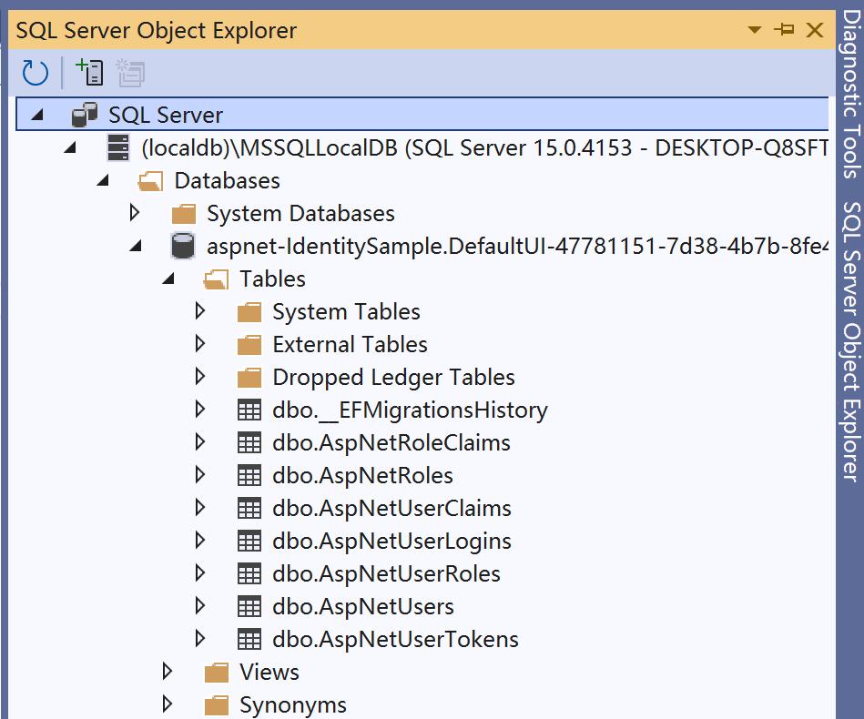
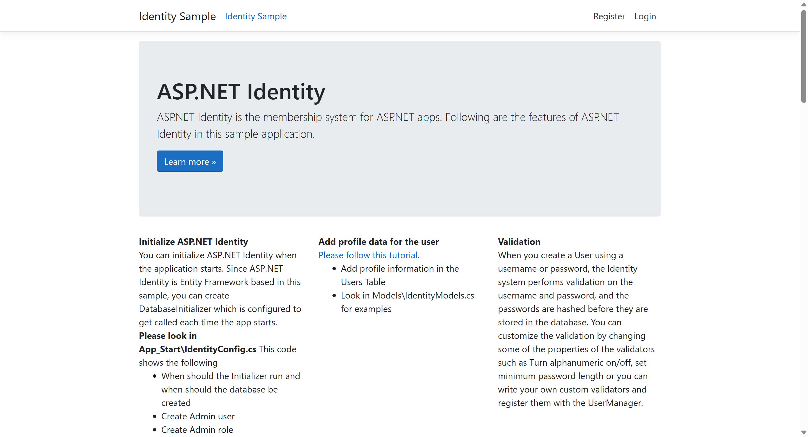
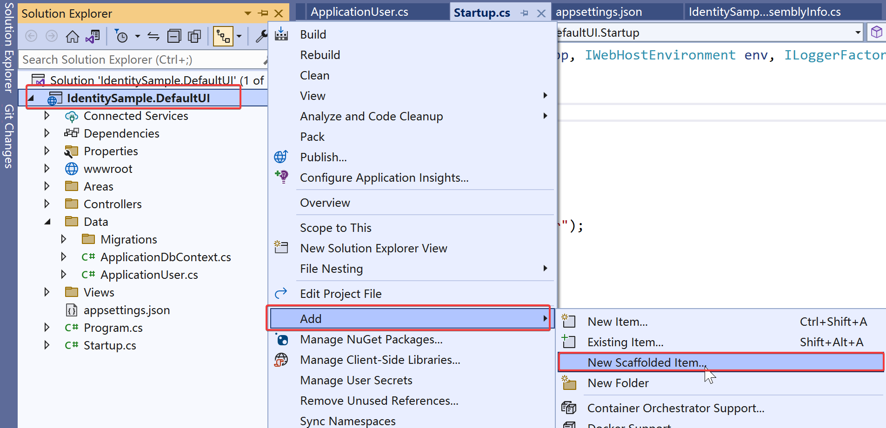
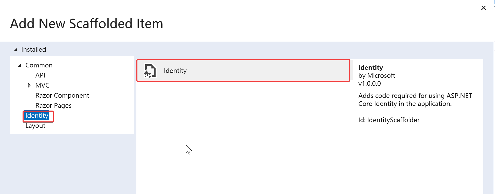
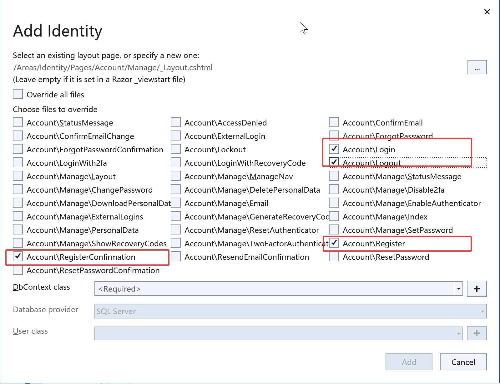

# ASP.NET Core identity 使用默认ui

## ASP.NET Core Identity DefaultUI 项目示例

| 地址 | .Net版本 |
| -------- | -------- |
|   [代码地址](https://github.com/happtim/mylinqpad/tree/main/AspNetCore/Security/Authentication/IdentitySample.DefaultUI)       | .Net7    | 


### 数据库配置

Identity API 使用Entity Framework Core 和 SQL Server。

首先，我们需要检查连接数据库字符串。打开`appsettings.json`文件并将连接字符串更新为正确的数据库位置，示例中使用的localdb作为数据库。

```json
  "ConnectionStrings": {
    "DefaultConnection": "Server=(localdb)\\mssqllocaldb;Database=aspnet-IdentitySample.DefaultUI-47781151-7d38-4b7b-8fe4-9a8b299f124f;Trusted_Connection=True;MultipleActiveResultSets=true"
  },
```

示例代码中 `add-migration` 脚本已经自带，在 Package Manager Console 中使用如下命令创建数据库。
```
PM> Update-Database
```

在数据库的管理工具中，查看已经创建好的数据库及表名称。




以下表格显示了实体名称、表格名称以及它们的功能。

|Entity|Table Name|Remarks|
|---|---|---|
|IdentityUser|AspNetUsers|存储用户信息的主要表格|
|IdentityUserClaim|AspNetUserClaims|保存与用户相关的claims|
|IdentityUserLogin|AspNetUserLogins|表格保存了关于第三方/外部登录的信息。|
|IdentityUserToken|AspNetUserTokens|用于存储从外部登录提供程序收到的令牌。|
|IdentityUserRole|AspNetUserRoles|包含了分配给用户的角色。|
|IdentityRole|AspNetRoles|用于存储角色|
|IdentityRoleClaim|AspNetRoleClaims|分配给角色的Claims|


### 程序启动运行

程序启动之后，您将看到以下屏幕。




#### Registering a new user

点击注册用户按钮就可以注册一个用户。注册时的密码有一些预定于配置，需要在程序的注册服务AddDefaultIdentity中配置。示例中配置：

```csharp
services.AddDefaultIdentity<ApplicationUser>(o => {
	o.SignIn.RequireConfirmedAccount = false; //是否需要电子邮件确认。 默认为 false。
	o.Password.RequireNonAlphanumeric = false; //密码是否必须包含非字母数字字符。 默认为 true。
	o.Password.RequireUppercase = false;//密码是否必须包含大写 ASCII 字符。 默认为 true。
	o.Password.RequireDigit = false; //密码是否必须包含数字。 默认为 true。
	o.Password.RequireLowercase = false; //密码是否必须包含小写 ASCII 字符。 默认为 true。
})
```

## 代码概览

### IdentityDbContext

Context类ApplicationDbContext位于Data文件夹中。Data文件夹还包含配置数据库的迁移文件。

```csharp
public class ApplicationDbContext : IdentityDbContext<ApplicationUser>
{
	public ApplicationDbContext(DbContextOptions<ApplicationDbContext> options) : base(options)
	{
	}
}
```

### Startup class

启动类的`ConfigureServices`方法配置了身份验证和`ApplicationDbContext`相关的服务。

```csharp
// This method gets called by the runtime. Use this method to add services to the container.
public void ConfigureServices(IServiceCollection services)
{
	// Add framework services.
	services.AddDbContext<ApplicationDbContext>(
		options => options.ConfigureWarnings(b => b.Log(CoreEventId.ManyServiceProvidersCreatedWarning))
			.UseSqlServer(Configuration.GetConnectionString("DefaultConnection"),
		x => x.MigrationsAssembly("IdentitySample.DefaultUI")));

	services.AddMvc().AddNewtonsoftJson();

	services.AddDefaultIdentity<ApplicationUser>(o => {
		o.SignIn.RequireConfirmedAccount = false; //是否需要电子邮件确认。 默认为 false。
		o.Password.RequireNonAlphanumeric = false; //密码是否必须包含非字母数字字符。 默认为 true。
		o.Password.RequireUppercase = false;//密码是否必须包含大写 ASCII 字符。 默认为 true。
		o.Password.RequireDigit = false; //密码是否必须包含数字。 默认为 true。
		o.Password.RequireLowercase = false; //密码是否必须包含小写 ASCII 字符。 默认为 true。
	})
	.AddRoles<IdentityRole>()
	.AddEntityFrameworkStores<ApplicationDbContext>();

	services.AddDatabaseDeveloperPageExceptionFilter();
}
```


AddDefaultIdentity配置Identity服务。您可以使用选项来配置Identity API的行为。

Identity提供了三种注册服务的方法。
- AddDefaultIdentity
- AddIdentity
- AddIdentityCore

identity中 AddDefaultIdentity，AddIdentity和AddIdentityCore有什么区别？

>1. AddDefaultIdentity: AddDefaultIdentity是ASP.NET Core Identity提供的一个快速配置方法，用于向应用程序添加默认的用户模型、登录和注册页面。它会自动配置身份验证和授权的相关服务以及默认的UI页面，适用于通常的用户认证和授权需求。可以通过传递泛型参数指定用户模型类。
>
```csharp
public static IdentityBuilder AddDefaultIdentity<TUser>(this IServiceCollection services, Action<IdentityOptions> configureOptions) where TUser : class
    {
        services.AddAuthentication(o =>
        {
            o.DefaultScheme = IdentityConstants.ApplicationScheme;
            o.DefaultSignInScheme = IdentityConstants.ExternalScheme;
        })
        .AddIdentityCookies(o => { });

        return services.AddIdentityCore<TUser>(o =>
        {
            o.Stores.MaxLengthForKeys = 128;
            configureOptions?.Invoke(o);
        })
            .AddDefaultUI()
            .AddDefaultTokenProviders();
}
```
>
>  
>2. AddIdentity: AddIdentity方法用于向应用程序添加自定义用户模型以及身份验证和授权的相关服务。它提供了更多的配置选项和自定义能力。通过AddIdentity方法，可以添加自定义的用户属性、密码策略、角色管理等功能。可以通过传递泛型参数指定用户模型类。

```csharp
public static IdentityBuilder AddIdentity<TUser, [DynamicallyAccessedMembers(DynamicallyAccessedMemberTypes.PublicConstructors)] TRole>(
        this IServiceCollection services,
        Action<IdentityOptions> setupAction)
        where TUser : class
        where TRole : class
    {
        // Services used by identity
        services.AddAuthentication(options =>
        {
            options.DefaultAuthenticateScheme = IdentityConstants.ApplicationScheme;
            options.DefaultChallengeScheme = IdentityConstants.ApplicationScheme;
            options.DefaultSignInScheme = IdentityConstants.ExternalScheme;
        })
        .AddCookie(IdentityConstants.ApplicationScheme, o =>
        {
            o.LoginPath = new PathString("/Account/Login");
            o.Events = new CookieAuthenticationEvents
            {
                OnValidatePrincipal = SecurityStampValidator.ValidatePrincipalAsync
            };
        })
        .AddCookie(IdentityConstants.ExternalScheme, o =>
        {
            o.Cookie.Name = IdentityConstants.ExternalScheme;
            o.ExpireTimeSpan = TimeSpan.FromMinutes(5);
        })
        .AddCookie(IdentityConstants.TwoFactorRememberMeScheme, o =>
        {
            o.Cookie.Name = IdentityConstants.TwoFactorRememberMeScheme;
            o.Events = new CookieAuthenticationEvents
            {
                OnValidatePrincipal = SecurityStampValidator.ValidateAsync<ITwoFactorSecurityStampValidator>
            };
        })
        .AddCookie(IdentityConstants.TwoFactorUserIdScheme, o =>
        {
            o.Cookie.Name = IdentityConstants.TwoFactorUserIdScheme;
            o.ExpireTimeSpan = TimeSpan.FromMinutes(5);
        });

        // Hosting doesn't add IHttpContextAccessor by default
        services.AddHttpContextAccessor();
        // Identity services
        services.TryAddScoped<IUserValidator<TUser>, UserValidator<TUser>>();
        services.TryAddScoped<IPasswordValidator<TUser>, PasswordValidator<TUser>>();
        services.TryAddScoped<IPasswordHasher<TUser>, PasswordHasher<TUser>>();
        services.TryAddScoped<ILookupNormalizer, UpperInvariantLookupNormalizer>();
        services.TryAddScoped<IRoleValidator<TRole>, RoleValidator<TRole>>();
        // No interface for the error describer so we can add errors without rev'ing the interface
        services.TryAddScoped<IdentityErrorDescriber>();
        services.TryAddScoped<ISecurityStampValidator, SecurityStampValidator<TUser>>();
        services.TryAddScoped<ITwoFactorSecurityStampValidator, TwoFactorSecurityStampValidator<TUser>>();
        services.TryAddScoped<IUserClaimsPrincipalFactory<TUser>, UserClaimsPrincipalFactory<TUser, TRole>>();
        services.TryAddScoped<IUserConfirmation<TUser>, DefaultUserConfirmation<TUser>>();
        services.TryAddScoped<UserManager<TUser>>();
        services.TryAddScoped<SignInManager<TUser>>();
        services.TryAddScoped<RoleManager<TRole>>();

        if (setupAction != null)
        {
            services.Configure(setupAction);
        }

        return new IdentityBuilder(typeof(TUser), typeof(TRole), services);
}
```
>3. AddIdentityCore: AddIdentityCore是Identity框架提供的一种轻量级方法，用于最低限度地配置身份验证和授权服务。它只提供了最基本的身份验证功能，不包含用户模型、密码策略、角色管理等高级功能。适用于只需最基本认证需求的应用程序。无法通过泛型参数指定用户模型类，需要手动构建UserPrincipal对象并进行注册。

```csharp
    public static IdentityBuilder AddIdentityCore<TUser>(this IServiceCollection services, Action<IdentityOptions> setupAction)
        where TUser : class
    {
        // Services identity depends on
        services.AddOptions().AddLogging();

        // Services used by identity
        services.TryAddScoped<IUserValidator<TUser>, UserValidator<TUser>>();
        services.TryAddScoped<IPasswordValidator<TUser>, PasswordValidator<TUser>>();
        services.TryAddScoped<IPasswordHasher<TUser>, PasswordHasher<TUser>>();
        services.TryAddScoped<ILookupNormalizer, UpperInvariantLookupNormalizer>();
        services.TryAddScoped<IUserConfirmation<TUser>, DefaultUserConfirmation<TUser>>();
        // No interface for the error describer so we can add errors without rev'ing the interface
        services.TryAddScoped<IdentityErrorDescriber>();
        services.TryAddScoped<IUserClaimsPrincipalFactory<TUser>, UserClaimsPrincipalFactory<TUser>>();
        services.TryAddScoped<UserManager<TUser>>();

        if (setupAction != null)
        {
            services.Configure(setupAction);
        }

        return new IdentityBuilder(typeof(TUser), services);
    }
```

AddEntityFrameworkStores配置Identity使用Entity Framework Core。我们还需要指定要在存储中使用的上下文的类型。

### Authentication Middleware

Identity API 内部包括了身份验证中间件。

身份验证中间件用于验证用户。我们通过使用UseAuthentication扩展方法将其添加到中间件管道中。

内置的身份验证中间件执行的一个重要任务是读取Cookie并构建ClaimsPrincipal，并更新HttpContext中的User对象。身份验证中间件使用默认的身份验证处理程序即Cookie身份验证处理程序来读取响应中的Cookie并构建ClaimsPrincipal。

这将使得在UseAuthentication()之后出现的所有中间件都知道用户已经经过身份验证。

我们必须调用UseAuthentication
- 在UseRouting之后，以便身份验证决策可用于路由信息。
- 在UseEndpoints和UseAuthorization之前调用，以便在访问端点之前对用户进行身份验证。

```csharp
app.UseRouting();

app.UseAuthentication();
app.UseAuthorization();

app.UseEndpoints(endpoints =>
{
	endpoints.MapDefaultControllerRoute();
	endpoints.MapRazorPages();
});
```


## Scaffold Identity UI in ASP.NET Core

所有的UI表单现在都是Razor类库的一部分，在命名空间Microsoft.AspNetCore.Identity.UI中。这就是为什么你在项目中找不到它们的原因。这是ASP.NET Core 2.1中引入的一个新功能。

Identity Razor类库隐藏了所有的UI表单、服务等内容。但是如果您想要修改或自定义它们呢？ASP.NET Core提供了一种选项，可以脚手架生成Identity UI并提取源代码，然后将其添加到我们的项目中。

如何做？
1. 右键Project
2. 点击Add
3. 点击 New Scaffolded Item



在弹出的窗口中选择 Identity 






### Register Form

通过点击“注册”按钮来注册新用户，这将调用OnPostAsync方法。

```csharp
public async Task<IActionResult> OnPostAsync(string returnUrl = null)
{
	returnUrl ??= Url.Content("~/");
	ExternalLogins = (await _signInManager.GetExternalAuthenticationSchemesAsync()).ToList();
	if (ModelState.IsValid)
	{
		var user = CreateUser();

		await _userStore.SetUserNameAsync(user, Input.Email, CancellationToken.None);
		await _emailStore.SetEmailAsync(user, Input.Email, CancellationToken.None);
		var result = await _userManager.CreateAsync(user, Input.Password);

		if (result.Succeeded)
		{
			_logger.LogInformation("User created a new account with password.");

			var userId = await _userManager.GetUserIdAsync(user);
			var code = await _userManager.GenerateEmailConfirmationTokenAsync(user);
			code = WebEncoders.Base64UrlEncode(Encoding.UTF8.GetBytes(code));
			var callbackUrl = Url.Page(
				"/Account/ConfirmEmail",
				pageHandler: null,
				values: new { area = "Identity", userId = userId, code = code, returnUrl = returnUrl },
				protocol: Request.Scheme);

			await _emailSender.SendEmailAsync(Input.Email, "Confirm your email",
				$"Please confirm your account by <a href='{HtmlEncoder.Default.Encode(callbackUrl)}'>clicking here</a>.");

			if (_userManager.Options.SignIn.RequireConfirmedAccount)
			{
				return RedirectToPage("RegisterConfirmation", new { email = Input.Email, returnUrl = returnUrl });
			}
			else
			{
				await _signInManager.SignInAsync(user, isPersistent: false);
				return LocalRedirect(returnUrl);
			}
		}
		foreach (var error in result.Errors)
		{
			ModelState.AddModelError(string.Empty, error.Description);
		}
	}

	// If we got this far, something failed, redisplay form
	return Page();
}
```

#### Creating User

UserManager.CreateAsync()方法会注册新用户。

```csharp
 var user = CreateUser();
await _userStore.SetUserNameAsync(user, Input.Email, CancellationToken.None);
await _emailStore.SetEmailAsync(user, Input.Email, CancellationToken.None);
var result = await _userManager.CreateAsync(user, Input.Password);
```


#### Sending Confirmation Email

GenerateEmailConfirmationTokenAsync() 会创建电子邮件确认码。使用该码，Url.Page 方法会生成电子邮件确认链接（即 callbackUrl）。

```csharp
var userId = await _userManager.GetUserIdAsync(user);
var code = await _userManager.GenerateEmailConfirmationTokenAsync(user);
code = WebEncoders.Base64UrlEncode(Encoding.UTF8.GetBytes(code));
var callbackUrl = Url.Page(
	"/Account/ConfirmEmail",
	pageHandler: null,
	values: new { area = "Identity", userId = userId, code = code, returnUrl = returnUrl },
	protocol: Request.Scheme);


```


SendEmailAsync方法会将带有上述URL的确认邮件发送到用户的电子邮箱。我们期望用户点击上述链接来确认他的账户。

```csharp
await _emailSender.SendEmailAsync(Input.Email, "Confirm your email",
	$"Please confirm your account by <a href='{HtmlEncoder.Default.Encode(callbackUrl)}'>clicking here</a>.");
```

请注意，仅当我们配置了电子邮件服务时才会发送邮件。由于我们尚未完成配置，目前不会发送任何电子邮件。

但是该账户尚未确认。根据Options.SignIn.RequireConfirmedAccount的值，我们有两个选择。
- 设置为true，则用户未登录，但会被重定向到注册确认页面。
- 设置为false，则用户会自动登录，无需使用SignInAsync方法进行确认。

```csharp
if (_userManager.Options.SignIn.RequireConfirmedAccount)
{
	return RedirectToPage("RegisterConfirmation", new { email = Input.Email, returnUrl = returnUrl });
}
else
{
	await _signInManager.SignInAsync(user, isPersistent: false);
	return LocalRedirect(returnUrl);
}
```

### RegisterConfirmation Form

如果设置RequireConfirmedAccount为true，则Identity API会在成功注册后将用户导向RegisterConfirmation页面。

```csharp
public async Task<IActionResult> OnGetAsync(string email, string returnUrl = null)
{
	if (email == null)
	{
		return RedirectToPage("/Index");
	}
	returnUrl = returnUrl ?? Url.Content("~/");

	var user = await _userManager.FindByEmailAsync(email);
	if (user == null)
	{
		return NotFound($"Unable to load user with email '{email}'.");
	}

	Email = email;
	// Once you add a real email sender, you should remove this code that lets you confirm the account
	DisplayConfirmAccountLink = true;
	if (DisplayConfirmAccountLink)
	{
		var userId = await _userManager.GetUserIdAsync(user);
		var code = await _userManager.GenerateEmailConfirmationTokenAsync(user);
		code = WebEncoders.Base64UrlEncode(Encoding.UTF8.GetBytes(code));
		EmailConfirmationUrl = Url.Page(
			"/Account/ConfirmEmail",
			pageHandler: null,
			values: new { area = "Identity", userId = userId, code = code, returnUrl = returnUrl },
			protocol: Request.Scheme);
	}

	return Page();
}
```

理想情况下，这个页面应该提醒用户在登录系统之前确认他的电子邮件。

但在测试或开发期间，您可能没有设置电子邮件服务。因此，身份验证 API 在此表单中提供了电子邮件确认链接的显示。这样我们就可以确认账户。

当 DisplayConfirmAccountLink 为 true 时，该代码会生成并显示电子邮件确认链接。您可以点击链接来确认您的账户。

### Login Form

当表单加载时（OnGetAsync），它通过在HTTPContext对象上调用SignOutAsync方法来清除现有的外部Cookie。

它还加载ExternalLogins以在登录界面中显示它们。

```csharp
public async Task OnGetAsync(string returnUrl = null)
{
	if (!string.IsNullOrEmpty(ErrorMessage))
	{
		ModelState.AddModelError(string.Empty, ErrorMessage);
	}

	returnUrl ??= Url.Content("~/");

	// Clear the existing external cookie to ensure a clean login process
	await HttpContext.SignOutAsync(IdentityConstants.ExternalScheme);

	ExternalLogins = (await _signInManager.GetExternalAuthenticationSchemesAsync()).ToList();

	ReturnUrl = returnUrl;
}
```

当用户点击登录按钮时，将执行OnPostAsync方法。

然后，它使用电子邮件和密码调用PasswordSignInAsync方法来登录用户。

```csharp
public async Task<IActionResult> OnPostAsync(string returnUrl = null)
{
	returnUrl ??= Url.Content("~/");

	ExternalLogins = (await _signInManager.GetExternalAuthenticationSchemesAsync()).ToList();

	if (ModelState.IsValid)
	{
		// This doesn't count login failures towards account lockout
		// To enable password failures to trigger account lockout, set lockoutOnFailure: true
		var result = await _signInManager.PasswordSignInAsync(Input.Email, Input.Password, Input.RememberMe, lockoutOnFailure: false);
		if (result.Succeeded)
		{
			_logger.LogInformation("User logged in.");
			return LocalRedirect(returnUrl);
		}
		if (result.RequiresTwoFactor)
		{
			return RedirectToPage("./LoginWith2fa", new { ReturnUrl = returnUrl, RememberMe = Input.RememberMe });
		}
		if (result.IsLockedOut)
		{
			_logger.LogWarning("User account locked out.");
			return RedirectToPage("./Lockout");
		}
		else
		{
			ModelState.AddModelError(string.Empty, "Invalid login attempt.");
			return Page();
		}
	}

	// If we got this far, something failed, redisplay form
	return Page();
}
```

PasswordSignInAsync方法会执行以下操作：

1. 验证用户是否存在和密码是否匹配。
2. 如果密码/邮箱不匹配，则返回Succeeded属性设置为false。
3. 如果用户启用了双重身份验证，则返回RequiresTwoFactor属性设置为true。
4. 如果用户的失败登录次数超过了最大限制（MaxFailedAccessAttempts），则返回IsLockedOut属性设置为true。
5. 如果一切正常：
	1. 创建一个包含用户信息的ClaimsIdentity。
	2. 从ClaimsIdentity创建一个ClaimsPrincipal。
	3. 使用ClaimsPrincipal调用HTTPContext.SignInAsync方法登录用户。
	```csharp
	public virtual async Task SignInWithClaimsAsync(TUser user, AuthenticationProperties? authenticationProperties, IEnumerable<Claim> additionalClaims)
    {
        var userPrincipal = await CreateUserPrincipalAsync(user);
        foreach (var claim in additionalClaims)
        {
            userPrincipal.Identities.First().AddClaim(claim);
        }
        await Context.SignInAsync(IdentityConstants.ApplicationScheme,
            userPrincipal,
            authenticationProperties ?? new AuthenticationProperties());
    }
	```
1. 返回Succeeded属性设置为true。

### Logout Form

注销调用SignOutAsync方法从上下文中删除所有的 cookie。

```csharp
public async Task<IActionResult> OnPost(string returnUrl = null)
{
	await _signInManager.SignOutAsync();
	_logger.LogInformation("User logged out.");
	if (returnUrl != null)
	{
		return LocalRedirect(returnUrl);
	}
	else
	{
		// This needs to be a redirect so that the browser performs a new
		// request and the identity for the user gets updated.
		return RedirectToPage();
	}
}
```