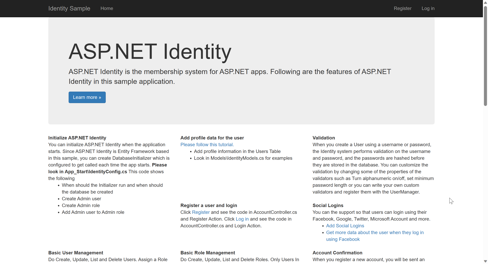

# ASP.NET Core identity 使用Mvc

## 项目示例

该示例代码没有使用默认的UI界面，而是使用的MVC方式提供界面。

| 地址 | .Net版本 |
| -------- | -------- |
|   [代码地址](https://github.com/happtim/mylinqpad/tree/main/AspNetCore/Security/Authentication/IdentitySample.Mvc)      | .Net7    | 


### 数据库配置

Identity API 使用Entity Framework Core 和 SQL Server。

首先，我们需要检查连接数据库字符串。打开`appsettings.json`文件并将连接字符串更新为正确的数据库位置，示例中使用的localdb作为数据库。

```json
  "ConnectionStrings": {
    "DefaultConnection": "Server=(localdb)\\mssqllocaldb;Database=IdentitySample-MVC-1-10;Trusted_Connection=True;MultipleActiveResultSets=true"
  },
```

示例代码中 `add-migration` 脚本已经自带，在 Package Manager Console 中使用如下命令创建数据库。

```
PM> Update-Database
```


### 程序启动运行

程序启动之后，您将看到以下屏幕。




## 代码概览

### IdentityDbContext

Context类ApplicationDbContext位于Models文件夹中。Data文件夹包含配置数据库的迁移文件。

```csharp
public class ApplicationDbContext : IdentityDbContext<ApplicationUser>
{
	public ApplicationDbContext(DbContextOptions options) : base(options) { }

	protected override void OnModelCreating(ModelBuilder builder)
	{
		base.OnModelCreating(builder);
		// Customize the ASP.NET Identity model and override the defaults if needed.
		// For example, you can rename the ASP.NET Identity table names and more.
		// Add your customizations after calling base.OnModelCreating(builder);
	}
}
```

### ConfigureServices

```csharp
// Add framework services.
builder.Services.AddDbContext<ApplicationDbContext>(options =>
{
    options.UseSqlServer(builder.Configuration.GetConnectionString("DefaultConnection"));
    options.ConfigureWarnings(b => b.Log(CoreEventId.ManyServiceProvidersCreatedWarning));
});

builder.Services.AddMvc();

builder.Services.AddIdentityCore<ApplicationUser>(o => 
    {
        o.SignIn.RequireConfirmedAccount = false; 
        o.Password.RequireNonAlphanumeric = false; 
        o.Password.RequireUppercase = false;
        o.Password.RequireDigit = false;
        o.Password.RequireLowercase = false; 
    })
    .AddRoles<IdentityRole>()
    .AddEntityFrameworkStores<ApplicationDbContext>()
    .AddSignInManager()
    .AddDefaultTokenProviders();

builder.Services.AddAuthentication(o =>
{
    o.DefaultScheme = IdentityConstants.ApplicationScheme;
    o.DefaultSignInScheme = IdentityConstants.ExternalScheme;
})
.AddIdentityCookies(o => { });

// Add application services.
builder.Services.AddTransient<IEmailSender, AuthMessageSender>();
builder.Services.AddTransient<ISmsSender, AuthMessageSender>();

builder.Services.AddDatabaseDeveloperPageExceptionFilter();
```


核心注册代码`AddIdentityCore`中，`builder.Services.AddIdentityCore<ApplicationUser>(o => {...})`用于配置身份验证的核心服务。在这里，我们将禁用了账户确认功能（RequireConfirmedAccount设为false），并且设置密码要求，其中RequireNonAlphanumeric，RequireUppercase，RequireDigit和RequireLowercase都被设置为false，意味着密码不需要包含非字母数字字符、大写字母、数字或小写字母。

接下来，通过`.AddRoles<IdentityRole>()`将角色服务添加到身份验证服务中， 
然后使用`.AddEntityFrameworkStores<ApplicationDbContext>()`将身份相关的数据（如用户、角色、登录等）存储到`ApplicationDbContext`中。

接着，通过.AddSignInManager()将SignInManager服务添加到身份验证服务中，SignInManager用于处理用户登录。

最后，通过.AddDefaultTokenProviders()添加默认的令牌提供程序，以便使用身份验证时可以生成和验证令牌。当我们邮件确认注册，或者邮件找回的时候，发送邮件里面包含一个token就是由`DataProtectorTokenProvider`产生的。当我们绑定手机发送验证码时，发送的6位数字就是由`PhoneNumberTokenProvider`产生的。 具体验证过程讲解在[[identity-token-provider]]

第二个部分注册`AddAuthentication`服务中，`builder.Services.AddAuthentication(o => {...})`用于配置身份验证中间件。在这里，我们将默认的身份验证方案设置为`IdentityConstants.ApplicationScheme`，将默认的登录方案设置为`IdentityConstants.ExternalScheme`。

使用`.AddIdentityCookies(o => { })`可以向身份验证中间件添加必要的Cookie配置。

### 注册中间件

```csharp
if (app.Environment.IsDevelopment())
{
    app.UseDeveloperExceptionPage();
    app.UseMigrationsEndPoint();
}
else
{
    app.UseExceptionHandler("/Home/Error");
}

app.UseStaticFiles();

app.UseRouting();

app.UseAuthentication();
app.UseAuthorization();

app.UseEndpoints(endpoints =>
{
    endpoints.MapDefaultControllerRoute();
    endpoints.MapRazorPages();
});

app.Run();
```


### Register User

```csharp
//
// POST: /Account/Register
[HttpPost]
[AllowAnonymous]
[ValidateAntiForgeryToken]
public async Task<IActionResult> Register(RegisterViewModel model, string returnUrl = null)
{
	ViewData["ReturnUrl"] = returnUrl;
	if (ModelState.IsValid)
	{
		var user = new ApplicationUser { UserName = model.Email, Email = model.Email };
		var result = await _userManager.CreateAsync(user, model.Password);
		if (result.Succeeded)
		{
			// For more information on how to enable account confirmation and password reset please visit http://go.microsoft.com/fwlink/?LinkID=532713
			// Send an email with this link
			//var code = await _userManager.GenerateEmailConfirmationTokenAsync(user);
			//var callbackUrl = Url.Action("ConfirmEmail", "Account", new { userId = user.Id, code = code }, protocol: HttpContext.Request.Scheme);
			//await _emailSender.SendEmailAsync(model.Email, "Confirm your account",
			//    "Please confirm your account by clicking this link: <a href=\"" + callbackUrl + "\">link</a>");
			await _signInManager.SignInAsync(user, isPersistent: false);
			_logger.LogInformation(3, "User created a new account with password.");
			return RedirectToLocal(returnUrl);
		}
		AddErrors(result);
	}

	// If we got this far, something failed, redisplay form
	return View(model);
}
```

上述代码如果`ModelState`验证通过，说明用户提交的注册信息有效，接下来会执行以下步骤：

1. 创建一个`ApplicationUser`对象，设置用户名和电子邮件为用户在表单中输入的值。
2. 使用`_userManager`的`CreateAsync`方法创建用户。
3. 如果用户创建成功，发生确认邮件给邮箱中。
4. 然后将通过`_signInManager`的`SignInAsync`方法自动为用户进行登录。
5. 记录一个信息到日志中，表示用户成功创建了一个新的账户。
6. 使用`RedirectToLocal`方法将用户重定向到`returnUrl`指定的页面。

如果`ModelState`验证失败，那么说明用户提交的注册信息无效，将会调用`AddErrors`方法将验证错误添加到`ModelState`中，并返回一个带有错误信息的视图。

### Login

```csharp
//
// POST: /Account/Login
[HttpPost]
[AllowAnonymous]
[ValidateAntiForgeryToken]
public async Task<IActionResult> Login(LoginViewModel model, string returnUrl = null)
{
	ViewData["ReturnUrl"] = returnUrl;
	if (ModelState.IsValid)
	{
		// This doesn't count login failures towards account lockout
		// To enable password failures to trigger account lockout, set lockoutOnFailure: true
		var result = await _signInManager.PasswordSignInAsync(model.Email, model.Password, model.RememberMe, lockoutOnFailure: false);
		if (result.Succeeded)
		{
			_logger.LogInformation(1, "User logged in.");
			return RedirectToLocal(returnUrl);
		}
		if (result.RequiresTwoFactor)
		{
			return RedirectToAction(nameof(SendCode), new { ReturnUrl = returnUrl, RememberMe = model.RememberMe });
		}
		if (result.IsLockedOut)
		{
			_logger.LogWarning(2, "User account locked out.");
			return View("Lockout");
		}
		else
		{
			ModelState.AddModelError(string.Empty, "Invalid login attempt.");
			return View(model);
		}
	}

	// If we got this far, something failed, redisplay form
	return View(model);
}
```

上述代码中先检查ModelState是否有效，如果有效，则调用_signInManager.PasswordSignInAsync方法进行用户登录验证。如果登录成功，将用户重定向到returnUrl指定的页面。如果需要进行二次验证，则重定向到SendCode方法。如果用户账号被锁定，则返回一个Lockout视图。如果登录验证失败，则在ModelState中添加错误信息后返回登录页面。

如果ModelState无效或登录验证失败，将返回登录页面进行重新显示。

### logout

```csharp
//
// POST: /Account/LogOff
[HttpPost]
[ValidateAntiForgeryToken]
public async Task<IActionResult> LogOff()
{
	await _signInManager.SignOutAsync();
	_logger.LogInformation(4, "User logged out.");
	return RedirectToAction(nameof(HomeController.Index), "Home");
}
```

使用`_signInManager.SignOutAsync()`方法进行登出，这将使用户的身份认证信息无效。

### ForgotPassword

```csharp
//
// POST: /Account/ForgotPassword
[HttpPost]
[AllowAnonymous]
[ValidateAntiForgeryToken]
public async Task<IActionResult> ForgotPassword(ForgotPasswordViewModel model)
{
	if (ModelState.IsValid)
	{
		var user = await _userManager.FindByEmailAsync(model.Email);
		if (user == null || !(await _userManager.IsEmailConfirmedAsync(user)))
		{
			// Don't reveal that the user does not exist or is not confirmed
			return View("ForgotPasswordConfirmation");
		}

		// For more information on how to enable account confirmation and password reset please visit http://go.microsoft.com/fwlink/?LinkID=532713
		// Send an email with this link
		var code = await _userManager.GeneratePasswordResetTokenAsync(user);
		var callbackUrl = Url.Action("ResetPassword", "Account", new { userId = user.Id, code = code }, protocol: HttpContext.Request.Scheme);
		await _emailSender.SendEmailAsync(model.Email, "Reset Password",
		   "Please reset your password by clicking here: <a href=\"" + callbackUrl + "\">link</a>");
		return View("ForgotPasswordConfirmation");
	}

	// If we got this far, something failed, redisplay form
	return View(model);
}
```

首先，检查输入的数据是否有效（ModelState.IsValid），如果无效，则返回当前视图。

如果数据有效，使用用户管理器（_userManager）通过电子邮件查找用户。如果找不到用户或用户未确认电子邮件，则返回一个视图来确认忘记密码的操作。

如果用户存在且电子邮件已确认，则生成一个重置密码的令牌（code）。

使用URL.Action方法创建一个重置密码的回调URL，URL包含了重置密码的操作的控制器和动作名（"ResetPassword", "Account"）以及用户ID和重置密码令牌。

使用电子邮件发送器（_emailSender）发送带有重置密码URL的电子邮件给指定的电子邮件地址（model.Email）。

返回一个视图来确认成功发送了重置密码的邮件。

### ResetPassword

忘记密码发送的url地址，点击开页面就是一个重置密码的界面。填写好密码之后提交。

```csharp
//
// POST: /Account/ResetPassword
[HttpPost]
[AllowAnonymous]
[ValidateAntiForgeryToken]
public async Task<IActionResult> ResetPassword(ResetPasswordViewModel model)
{
	if (!ModelState.IsValid)
	{
		return View(model);
	}
	var user = await _userManager.FindByEmailAsync(model.Email);
	if (user == null)
	{
		// Don't reveal that the user does not exist
		return RedirectToAction(nameof(AccountController.ResetPasswordConfirmation), "Account");
	}
	var result = await _userManager.ResetPasswordAsync(user, model.Code, model.Password);
	if (result.Succeeded)
	{
		return RedirectToAction(nameof(AccountController.ResetPasswordConfirmation), "Account");
	}
	AddErrors(result);
	return View();
}
```

首先，该方法检查ModelState是否有效，如果无效，则返回当前视图（即重置密码的表单视图），以显示错误消息。

然后，该方法通过用户管理器（\_userManager）根据提供的电子邮件查找用户。如果找不到对应的用户，则会将请求重定向到ResetPasswordConfirmation方法，并通过Account控制器来处理。这样做是为了不暴露用户不存在的事实。

如果找到了对应的用户，则会调用用户管理器的ResetPasswordAsync方法来重置用户的密码。重置密码时需要提供验证码（model.Code）和新密码（model.Password）。如果重置密码成功（result.Succeeded为true），则会将请求重定向到ResetPasswordConfirmation方法，并通过Account控制器来处理。

如果重置密码失败，则通过调用AddErrors方法将失败的结果中的错误添加到ModelState中，并返回当前视图以显示错误消息。