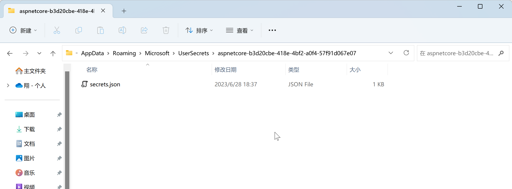
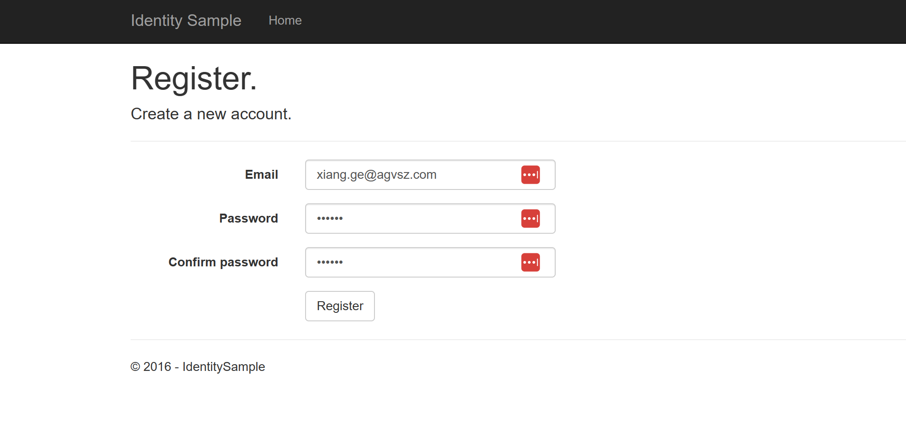
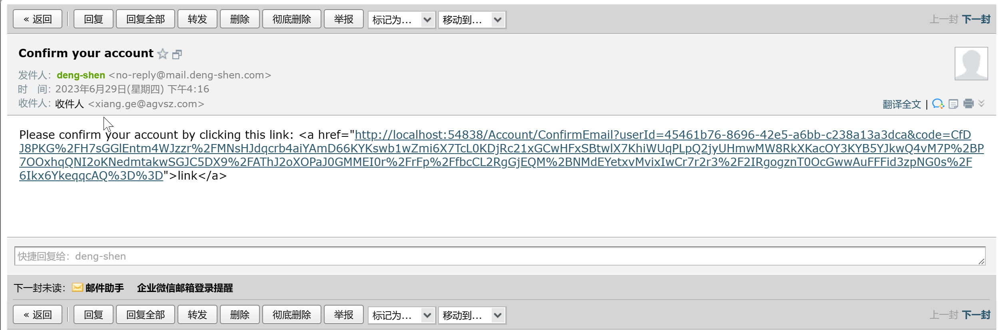

# ASP.NET Core identity 账户确认和密码找回

## 项目示例

该示例代码使用的MVC方式提供界面。

| 地址 | .Net版本 |
| -------- | -------- |
|   [代码地址](https://github.com/happtim/mylinqpad/tree/main/AspNetCore/Security/Authentication/IdentitySample.Mvc)      | .Net7    | 


### Configure an email provider

本例子使用腾讯云提供邮件服务，他使用SMTP服务发送邮件。

创建一个类来获取安全电子邮件密钥。对于此示例，创建`Services/AuthMessageSenderOptions.cs`文件。

```csharp
public class AuthMessageSenderOptions
{
	public string? SMTPPassword{ get; set; }

	public string? SMTPUsername { get; set; }
}
```

#### Configure SMTP user secrets

设置`SMTPPassword`和`SMTPUsername`通过[secret-manager tool](https://learn.microsoft.com/en-us/aspnet/core/security/app-secrets?view=aspnetcore-7.0).

```powershell
PM> dotnet user-secrets set SMTPUsername <key>
Successfully saved SMTPUsername = <key> to the secret store.
PM> dotnet user-secrets set SMTPPassword <key>
Successfully saved SMTPPassword = <key> to the secret store.
```

注意如果有特殊字符如`$`会截断后面的，设置好secrets.json 再去配置文件中检查一遍。

在Windows上，Secret Manager将键/值对存储在`%APPDATA%/Microsoft/UserSecrets/<WebAppName-userSecretsId>`目录下的`secrets.json`文件中。




在Linux上，Secret Manager将键/值对存储在`~/.microsoft/usersecrets/<userSecretsId>/secrets.json`

### Implement IEmailSender

IEmailSender 给编写实现类。这里没有使用系统StmpClient [[smtpclient]]，因为不支持ssl。

```csharp
public Task SendEmailAsync(string email, string subject, string body)
{
	if (string.IsNullOrEmpty(Options.SMTPPassword) || string.IsNullOrEmpty(Options.SMTPUsername) )
	{
		throw new Exception("Null SMTP Password Or Username");
	}

	string smtpServer = "gz-smtp.qcloudmail.com";
	int smtpPort = 465;

	string fromAddress = "no-reply@mail.deng-shen.com";

	// 创建邮件对象
	var message = new MimeMessage();
	message.From.Add(new MailboxAddress("deng-shen", fromAddress));
	message.To.Add(new MailboxAddress("收件人", email));
	message.Subject = subject;

	// 创建邮件正文
	var bodyBuilder = new BodyBuilder();
	bodyBuilder.TextBody = body;

	// 将正文添加到邮件中
	message.Body = bodyBuilder.ToMessageBody();

	try
	{
		// 创建 SmtpClient 对象
		using (var client = new SmtpClient())
		{
			// 连接到 SMTP 服务器
			client.Connect(smtpServer, smtpPort, true);

			// 使用 SMTP 服务器的身份验证凭据进行身份验证
			client.Authenticate(Options.SMTPUsername, Options.SMTPPassword);

			// 发送邮件
			client.Send(message);

			// 断开连接
			client.Disconnect(true);
		}
	}
	catch (Exception ex)
	{
		_logger.LogError("Failed to send email: " + ex.Message);
	}

	// Plug in your email service here to send an email.
	return Task.FromResult(0);
}
```

### Configure app to support email

将以下代码添加到Program.cs文件中：

- 将EmailSender添加为一个 transient scope。
- 注册AuthMessageSenderOptions配置实例。

```csharp
// Add application services.
builder.Services.AddTransient<IEmailSender, AuthMessageSender>();
builder.Services.AddTransient<ISmsSender, AuthMessageSender>();
builder.Services.Configure<AuthMessageSenderOptions>(builder.Configuration);
```

并且配置`AddIdentityCore`参数`o.SignIn.RequireConfirmedAccount`为true

### 修改注册代码发送邮件

sampleMVC 这个例子中注册发送邮件的代码是注释掉的。当我们写好了`IEmailSender`可以解除注释它了。

```csharp
//
// POST: /Account/Register
[HttpPost]
[AllowAnonymous]
[ValidateAntiForgeryToken]
public async Task<IActionResult> Register(RegisterViewModel model, string returnUrl = null)
{
	ViewData["ReturnUrl"] = returnUrl;
	if (ModelState.IsValid)
	{
		var user = new ApplicationUser { UserName = model.Email, Email = model.Email };
		var result = await _userManager.CreateAsync(user, model.Password);
		if (result.Succeeded)
		{
			// For more information on how to enable account confirmation and password reset please visit http://go.microsoft.com/fwlink/?LinkID=532713
			// Send an email with this link
			var code = await _userManager.GenerateEmailConfirmationTokenAsync(user);
			var callbackUrl = Url.Action("ConfirmEmail", "Account", new { userId = user.Id, code = code }, protocol: HttpContext.Request.Scheme);
			await _emailSender.SendEmailAsync(model.Email, "Confirm your account",
				"Please confirm your account by clicking this link: <a href=\"" + callbackUrl + "\">link</a>");
			await _signInManager.SignInAsync(user, isPersistent: false);
			_logger.LogInformation(3, "User created a new account with password.");
			return RedirectToLocal(returnUrl);
		}
		AddErrors(result);
	}

	// If we got this far, something failed, redisplay form
	return View(model);
}
```

## Test Register, confirm email, and reset password

运行网页应用程序，并测试账户确认和密码恢复流程。

1. 运行应用程序并注册一个新用户
2. 在电子邮件中检查账户确认链接。
4. 点击链接确认您的电子邮箱。
5. 使用您的电子邮件和密码登录。
5. 退出登录。




### Change email and activity timeout

默认cookie的`ExpireTimeSpan = TimeSpan.FromDays(14);` ,也就是说用户登录14天内有效。如果想更改默认有效时间。此方法也是Identity的扩展方法。

```csharp
builder.Services.ConfigureApplicationCookie(o => {
    o.ExpireTimeSpan = TimeSpan.FromDays(5);
    o.SlidingExpiration = true;
});
```

### Change all data protection token lifespans

默认的邮件链接有效时间是1天，可以通过如下配置修改有效时间。修改配置项是在`DataProtectionTokenProvider`验证的时候使用。

但是这样配置之后所用使用`DataProtectionTokenProvider`的Token提供者都需要1天。

```csharp
builder.Services.Configure<DataProtectionTokenProviderOptions>(o => o.TokenLifespan = TimeSpan.FromHours(3));
```

  
### Change the email token lifespan

上面修改是全局修改，如何想单独修改Email的链接有效时间，需要自定义`DataProtectionTokenProvider`

添加自定义的`DataProtectorTokenProvider<TUser>`和`DataProtectionTokenProviderOptions`。

```csharp
public class CustomEmailConfirmationTokenProvider<TUser>
                              :  DataProtectorTokenProvider<TUser> where TUser : class
{
    public CustomEmailConfirmationTokenProvider(
        IDataProtectionProvider dataProtectionProvider,
        IOptions<EmailConfirmationTokenProviderOptions> options,
        ILogger<DataProtectorTokenProvider<TUser>> logger)
                                       : base(dataProtectionProvider, options, logger)
    {

    }
}
public class EmailConfirmationTokenProviderOptions : DataProtectionTokenProviderOptions
{
    public EmailConfirmationTokenProviderOptions()
    {
        Name = "EmailDataProtectorTokenProvider";
        TokenLifespan = TimeSpan.FromHours(4);
    }
}
```

将自定义提供程序添加到服务容器中：

```csharp
builder.Services.AddDefaultIdentity<IdentityUser>(config =>
{
    config.SignIn.RequireConfirmedEmail = true;
    config.Tokens.ProviderMap.Add("CustomEmailConfirmation",
        new TokenProviderDescriptor(
            typeof(CustomEmailConfirmationTokenProvider<IdentityUser>)));
    config.Tokens.EmailConfirmationTokenProvider = "CustomEmailConfirmation";
}).AddEntityFrameworkStores<ApplicationDbContext>();

builder.Services.AddTransient<CustomEmailConfirmationTokenProvider<IdentityUser>>();
```