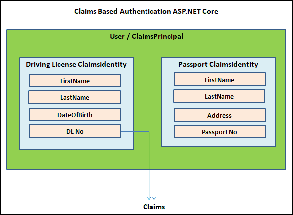

# ASP.NET Core中的身份验证

## What is Authentication

认证是验证个人身份的过程。它是确定用户是谁的过程。

例如，公司在入职时向员工提供身份证。员工需要在进入工作场所时出示或扫描他们的身份证。身份证可以唯一地识别员工，如果没有身份证，就无法进入。

同样，在网页应用中，我们需要在系统中创建用户。我们需要分配一个唯一的ID（如用户名或电子邮箱）和一个密钥（密码）。用户必须在登录页面输入ID和密码。只有当他提供有效的凭据时，他才会被认证并允许进入。

以下列出了一些常见的认证：
- Cookie-Based authentication
- Token-Based authentication
- Third-party access(OAuth, API-token)
- OpenId

## What is Authorization

授权确定用户允许执行的操作。

例如，员工无法访问工作场所内的所有内容。他只能进入授予权限的部门。例如，服务器房间只有IT人员可以进入。只有财务人员可以访问与财务相关的信息。

同样地，当用户登录时，经过身份验证。但他可能没有浏览管理区的权限。只有具有管理员权限（或声明）的用户才能访问管理区。

然而，在确定用户可以做什么之前，必须知道用户是谁。因此，授权之前必须进行身份验证。

## How Authentication & Authorisation Works
### Unauthenticated Request

当一个未经认证的用户发送请求到受保护的页面时。

1. 请求到达认证中间件。
2. 认证中间件检查请求中是否存在适当的凭据。它将使用默认的身份验证处理程序来进行检查。它可以是Cookies处理程序/ Jwt处理程序。由于没有找到任何凭据，它将将用户属性设置为匿名用户。
3. 授权中间件（UseAuthorization（））检查目标页面是否需要授权。
	1. 如果不需要，则允许用户访问该页面
	2. 如果需要，则在身份验证处理程序上调用ChallengeAsync（）。它将用户重定向到登录页面。

### Signing In

1. 用户在登录表单中输入ID和密码，然后点击登录按钮。
2. 请求经过身份验证和授权中间件后，到达登录端点。因此，登录端点必须有AllowAnonymous装饰器，否则请求将永远无法到达该端点。
3. 用户的ID和密码与数据库进行验证。
4. 如果使用Cookie身份验证处理程序
	1. 使用用户的声明创建一个ClaimsPrincipal
	2. 使用HttpContext.SignInAsync创建一个加密的Cookie，并将其添加到当前响应中。
	3. 响应返回给浏览器。
	4. 浏览器存储Cookie。
5. 如果使用JWT令牌验证处理程序
	1. 使用用户的声明创建一个JWT令牌。
	2. 将JWT令牌作为响应发送给用户。
	3. 用户读取令牌并将其存储在本地存储、会话存储甚至Cookie中。
6. 用户现在已进行身份验证。

### Authenticating the Subsequent Requests
1. 用户发出保护页面的请求。
2. 如果您使用的是cookie身份验证，则无需执行任何操作。浏览器会自动将cookie与每个请求一起发送。但是对于JWT令牌，您需要在授权头中包含该令牌。
3. 请求到达身份验证中间件。它将使用默认的身份验证处理程序读取cookie/JWT令牌，并构建ClaimsIdentity并使用它更新HttpContext.User属性。
4. 授权中间件通过检查HttpContext.User属性，判断用户是否已经通过身份验证，并允许其访问。

## Claims, ClaimsIdentity & ClaimsPrincipal

ASP.NET Core使用基于声明的身份验证。为了理解它，首先需要理解什么是声明、ClaimsIdentity和ClaimsPrincipal。

### Claim

Claim是关于用户的信息。它由声明类型和可选值组成。我们以名称-值对的形式存储它。一个声明可以是任何东西，例如姓名声明、电子邮件声明、角色声明、电话号码声明等。

授权模块使用声明来检查用户是否有权访问资源。

### ClaimsIdentity

ClaimsIdentity是一个Claims的集合。

例如，拿你的驾驶执照来说。它有类似于FirstName、LastName、DateOfBirth等的声明。因此，驾驶执照就是ClaimsIdentity。

### ClaimsPrincipal

ClaimsPrincipal包含一组ClaimsIdentity。你可以将ClaimsPrincipal（或称为Principal或Identity）看作你的应用程序的用户。

一个用户可以拥有多个ClaimsIdentity。例如，驾驶执照和护照。

驾驶执照是一个ClaimsIdentity，具有类似FirstName、LastName、DateOfBirth和DLNo等声明。护照是另一个ClaimsIdentity，具有类似FirstName、LastName、Address和PassportNo等声明。

两者都可以用来识别同一个用户或ClaimsPrincipal。

### Reading the ClaimsPrincipal

我们从HttpContext对象的User属性中读取ClaimsPrincipal。

我们接收到的每个请求都将有一个HttpContext对象。它保存了当前HTTP请求的信息。

HttpContext对象还将ClaimsPrincipal作为User属性公开。

认证中间件负责填充User属性。记住，我们使用UseAuthentication()方法在中间件管道中注册了认证中间件。

用户可以以多种方式登录系统。基于Cookie的认证和基于JWT令牌的认证是常用的方式。但是我们的认证中间件如何知道要使用哪种方式来填充User属性呢？

