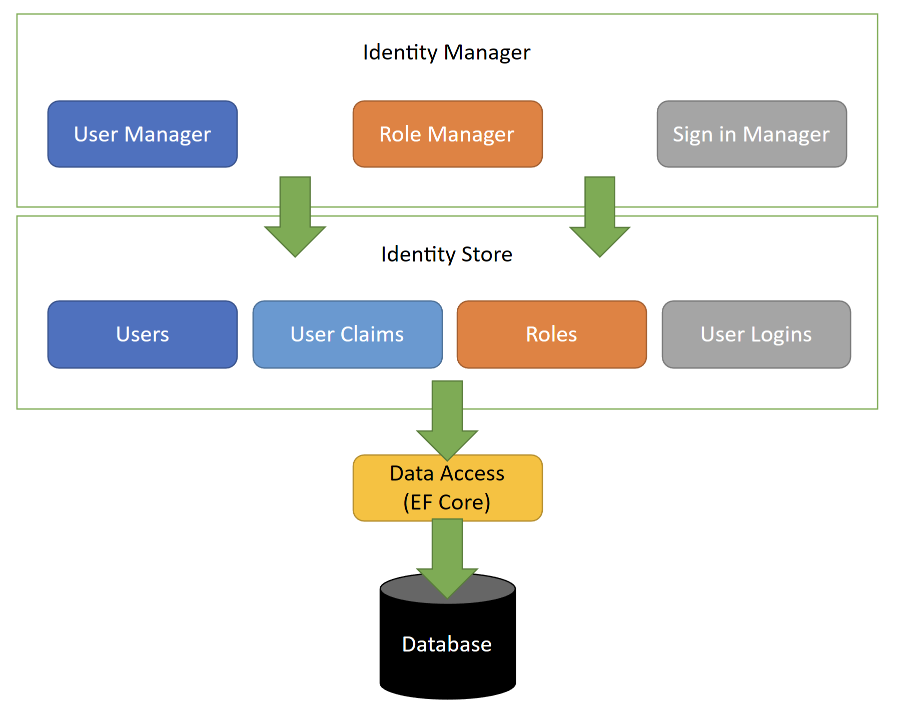

# identity 介绍

ASP.NET Core Identity是我们提供的自包含、开箱即用的解决方案。它包括以下内容：

1. Identity Manager：提供用于处理用户（包括声明和登录）和角色的API。
2. Identity Store接口：用于持久化身份信息（用户、声明、登录提供程序和角色）。
3. 针对关系型数据库的默认身份存储实现。您可以选择创建自己的自定义身份存储实现。
4. 身份验证系统（SignInManager）。
5. 用户管理界面（Identity UI）。

ASP.NET Core Identity提供了一套完整的解决方案，方便您管理用户认证、角色和身份信息。




>该描述引用 .Net 微软博客。
>[Improvements to auth and identity in ASP.NET Core 8 - .NET Blog (microsoft.com)](https://devblogs.microsoft.com/dotnet/improvements-auth-identity-aspnetcore-8/)

## ASP.NET Core Identity 架构

ASP.NET Core Identity由两个主要类别的类组成。它们是管理者（**Managers**）和存储 （**Stores**）。

### Managers

**Managers** 管理与身份相关的数据，如创建用户、添加角色等。它包括`UserManager`、`RoleManager`、`SignInManager`等诸如此类的类。

#### User Manager


**UserManager**是一个具体的类，用于管理用户。该类可以创建、更新和删除用户。它具有通过用户ID、用户名和电子邮件查找用户的方法。UserManager还提供了添加声明、删除声明、添加和删除角色等功能。它还可以生成密码哈希值，验证用户等。

#### SignIn Manager

**SignInManager**负责用户在应用程序中的登录和退出功能。它包含像`SignInAsync`、`SignOutAsync`等方法。在登录过程中，它会根据用户数据创建一个新的`ClaimsPrincipal`。然后将HttpContext.User属性设置为新的`ClaimsPrincipal`。接着，它会对Principal进行序列化、加密，并将它作为一个cookie保存起来。

Identity Api 使用Cookie Authentication管理认证，服务端在响应中将cookie发送到浏览器。浏览器在每个请求中将其返回给服务器。

### Stores

存储将用户、角色等持久化到数据源。

ASP.NET Core Identity API使用Entity Framework Core将用户信息存储在SQL Server数据库中。但你可以更改它以使用不同的数据库或ORM。

身份系统将存储和管理器解耦。因此，我们可以轻松地更改数据库提供程序，而不会中断整个应用程序。

下图显示了您的Web应用程序如何与管理器和存储交互。

## 配置

ASP.NET Core Identity 使用默认值来设置密码策略、锁定和 Cookie 配置等设置。这些设置可以在应用程序启动时进行覆盖。

IdentityOptions类表示用于配置Identity系统的选项。必须在调用AddIdentity或AddDefaultIdentity之后设置IdentityOptions。

### Claims Identity

|Property|Description|Default|
|---|---|---|
|RoleClaimType|	获取或设置用于角色声明的声明类型。|ClaimTypes.Role|
|SecurityStampClaimType|获取或设置用于安全戳声明的声明类型。	|AspNet.Identity.SecurityStamp|
|UserIdClaimType|获取或设置用于用户标识声明的声明类型。|ClaimTypes.NameIdentifier|
|UserNameClaimType|获取或设置用于用户名声明的声明类型。|ClaimTypes.Name|


### Lockout

Lockout 启用需要在代码_signInManager.PasswordSignInAsync 传参 lockoutOnFailure:true

```csharp
// This doesn't count login failures towards account lockout
// To enable password failures to trigger account lockout, set lockoutOnFailure: true
var result = await _signInManager.PasswordSignInAsync(Input.Email,
	 Input.Password, Input.RememberMe,
	 lockoutOnFailure: false);
```

成功的身份验证将重置失败的访问尝试计数，并重新启动计时器。默认配置如下。

```csharp
builder.Services.Configure<IdentityOptions>(options =>
{
    // Default Lockout settings.
    options.Lockout.DefaultLockoutTimeSpan = TimeSpan.FromMinutes(5);
    options.Lockout.MaxFailedAccessAttempts = 5;
    options.Lockout.AllowedForNewUsers = true;
});
```

### Password

默认情况下，身份验证要求密码包含大写字母、小写字母、数字和特殊字符。密码长度必须至少为六个字符，至少有一个唯一字符。默认配置如下：

```csharp
builder.Services.Configure<IdentityOptions>(options =>
{
    // Default Password settings.
    options.Password.RequireDigit = true;
    options.Password.RequireLowercase = true;
    options.Password.RequireNonAlphanumeric = true;
    options.Password.RequireUppercase = true;
    options.Password.RequiredLength = 6;
    options.Password.RequiredUniqueChars = 1;
});
```

### Sign-in

登录时是否需要确认邮箱，或者手机确认过。防止使用他人信息注册。

```csharp
builder.Services.Configure<IdentityOptions>(options =>
{
    // Default SignIn settings.
    options.SignIn.RequireConfirmedEmail = false;
    options.SignIn.RequireConfirmedPhoneNumber = false;
});
```

### Tokens

Token具体内容在 [[identity-token-provider]] 查看。

注意：TokenOptions.DefaultEmailProvider = "Email" 并未使用该配置。Email 相关Token使用的是 ''

|Property|Description|
|---|---|
|AuthenticatorTokenProvider|获取或设置用于使用认证器验证双重身份验证登录的AuthenticatorTokenProvider。|
|ChangeEmailTokenProvider|获取或设置 ChangeEmailTokenProvider，用于生成在电子邮件更改确认电子邮件中使用的令牌。|
|ChangePhoneNumberTokenProvider|获取或设置用于生成在更改电话号码时使用的令牌的ChangePhoneNumberTokenProvider。|
|EmailConfirmationTokenProvider|获取或设置用于生成账户确认电子邮件中使用的令牌的令牌提供程序。|
|PasswordResetTokenProvider|获取或设置用于生成重置密码电子邮件中使用的令牌的`IUserTwoFactorTokenProvider\<TUser>。|
|ProviderMap|用于使用键作为提供程序名称构建用户令牌提供程序。|

### User

`options.User.AllowedUserNameCharacters`用于设置允许的用户名字符。默认情况下，允许的用户名字符包括小写字母、大写字母、数字和特殊字符“-._@+”。

`options.User.RequireUniqueEmail`用于设置是否需要用户邮箱唯一。如果设置为`true`，则要求用户注册时提供唯一的邮箱地址。如果设置为`false`，则允许多个用户使用相同的邮箱地址进行注册。

```csharp
builder.Services.Configure<IdentityOptions>(options =>
{
    // Default User settings.
    options.User.AllowedUserNameCharacters =
            "abcdefghijklmnopqrstuvwxyzABCDEFGHIJKLMNOPQRSTUVWXYZ0123456789-._@+";
    options.User.RequireUniqueEmail = false;

});
```

### Cookie settings

在Program.cs文件中配置应用程序的cookie。在调用AddIdentity或AddDefaultIdentity之后必须调用ConfigureApplicationCookie。

```csharp
builder.Services.ConfigureApplicationCookie(options =>
{
    options.AccessDeniedPath = "/Identity/Account/AccessDenied";
    options.Cookie.Name = "YourAppCookieName";
    options.Cookie.HttpOnly = true;
    options.ExpireTimeSpan = TimeSpan.FromMinutes(60);
    options.LoginPath = "/Identity/Account/Login";
    // ReturnUrlParameter requires 
    //using Microsoft.AspNetCore.Authentication.Cookies;
    options.ReturnUrlParameter = CookieAuthenticationDefaults.ReturnUrlParameter;
    options.SlidingExpiration = true;
});
```

## Password Hasher options

这里我不是密码学专家，就先列出选项

|Option|Description|
|---|---|
|CompatibilityMode|哈希新密码时使用的兼容模式。默认为IdentityV3。哈希密码的第一个字节被称为格式标记，指定用于哈希密码的哈希算法的版本。在验证密码与哈希值匹配时，VerifyHashedPassword方法会根据第一个字节选择正确的算法。不论使用哪个版本的算法来哈希密码，客户端都能进行身份验证。设置兼容模式会影响对新密码的哈希处理。|
|IterationCount|在使用PBKDF2散列密码时使用的迭代次数。只有在CompatibilityMode设置为IdentityV3时才使用该值。该值必须是正整数，默认为10000。|