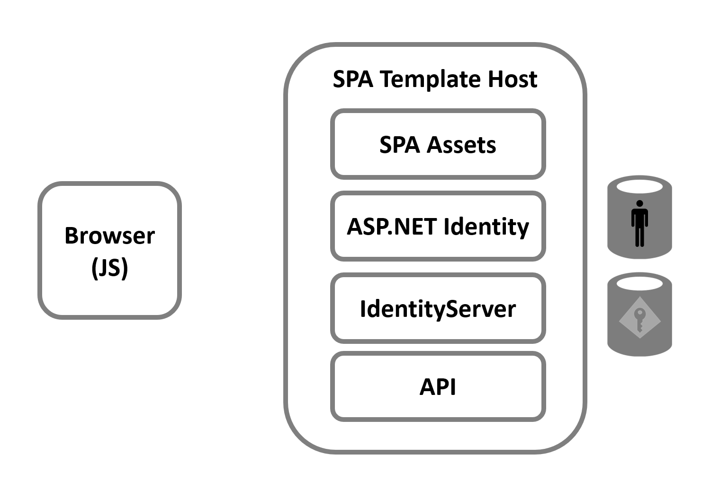
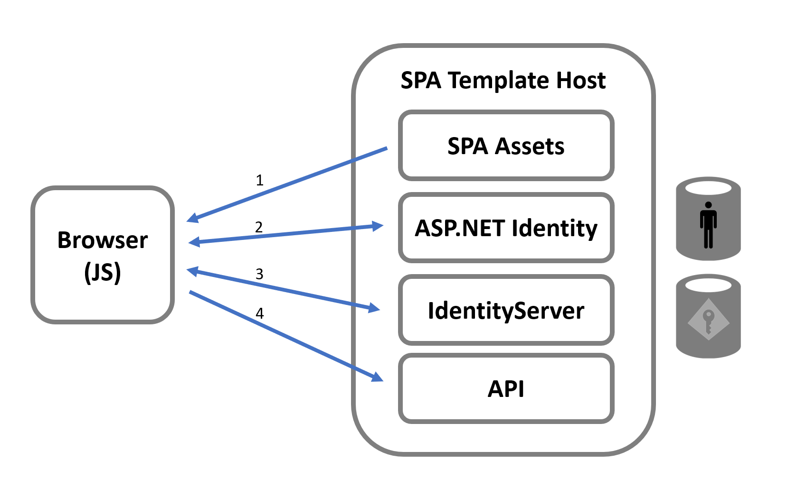
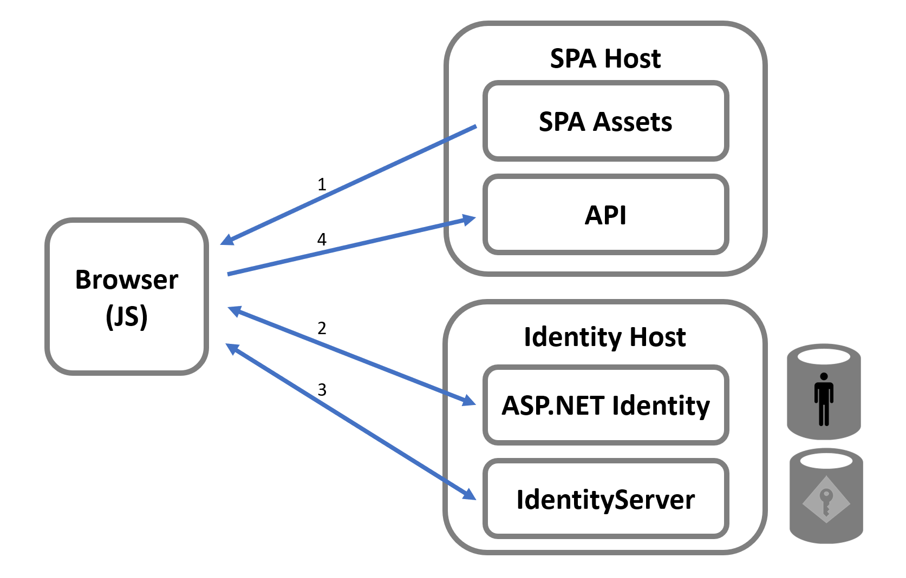
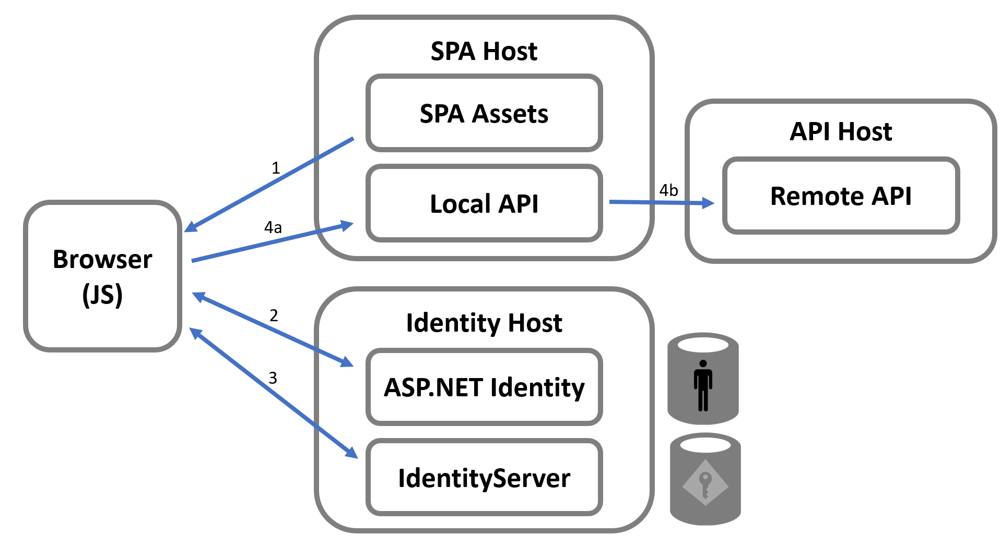

# IdentityServer Host 几种方式

微软发布了使用基于令牌的安全性进行 API 安全的模板，这些模板受到 ASP.NET Identity 身份管理库的支持。有几个模板，其中有两个用于使用 React 和 Angular 的基于 JavaScript 的 SPA 应用程序，还有一个用于 Blazor WASM 风格的 SPA 应用程序。所有这些模板都使用 Duende IdentityServer 作为令牌服务器，将令牌发布给浏览器中的客户端代码，以用于保护对 API 的调用。

本升级指南讨论了这些模板的设计模式，以及如何将它们迁移到更推荐的架构。该指南描述了高级架构，不涉及任何代码的具体细节，因此对于 SPA/JavaScript 模板以及 Blazor WASM 模板来说，应该足够使用。

## Template Architecture with a Single Host

下面是一张显示模板重要移动部件的图片。最重要的细节是，有一个单一的主机用于许多不同的概念项，这会影响整体设计的安全性。这一个主机提供以下功能：

- SPA资源（HTML，CSS和JS（React，Angular）或WASM（Blazor））
- ASP.NET身份UI页面（用于登录，注销，注册等）
- Duende IdentityServer（OIDC/OAuth协议端点的中间件）
- API

在最终保护对API的调用的工作流程方面，采取的逻辑步骤如下：

1：从主机加载SPA资源到浏览器。

2：然后，UI逻辑必须将用户导航到登录页面。登录会话基本上通过由ASP.NET cookie身份验证处理程序管理的Cookie进行跟踪。该身份验证处理程序由ASP.NET Identity配置。

3：一旦用户登录，SPA必须向Duende IdentityServer管理的端点发出OIDC/OAuth协议请求。前一步骤中的身份验证Cookie用于标识用户。此步骤的结果是一个由运行在浏览器中的代码维护的访问令牌。

4：最后，UI逻辑可以通过将访问令牌作为Authorization HTTP标头传递来安全地调用API。服务器上的代码将验证访问令牌是由托管在此项目中的Duende IdentityServer实例发布的。

下图显示了这些逻辑步骤。

## Architecture with Separate Hosts

尽管上述架构可以工作，但模板中呈现的设计存在一些缺点。在单个主机中使用两种不同的凭据类型（ cookies和tokens）存在明显的复杂性。模板中采用了许多技巧（隐藏在各种扩展方法和DI系统的配置中），接受API调用的访问令牌，但只接受ASP.NET Identity Pages和Duende IdentityServer端点的身份验证cookie。

与此相关的是，将令牌服务器（即Duende IdentityServer）与应用程序和API共同托管不是建议的模式。使用令牌服务器的目的是实现用户身份验证的集中化，从而为用户实现单点登录。将令牌服务器与客户端应用程序（和API）共同托管与该目标相违背。因此，推荐的方法是将Duende IdentityServer（以及ASP.NET Identity Pages）托管在与应用程序和API不同的主机上。这样做将产生以下架构图：

逻辑工作流程的步骤将保持不变，但是现在令牌服务器与任何一个应用程序或API独立。此外，现在每个主机只需要关注一种凭证类型，这简化了安全模型。一旦您决定将新的应用程序或API添加到您的架构中，将它们与现有的令牌服务器集成起来将需要很少的工作量。当然，您的用户将在所有这些应用程序中实现单一登录。最后，从部署的角度来看，各个不同的主机是独立的，并且可以根据需要单独更新/版本化/修补。

## BFF Architecture with a Remote API

关于SPA调用API的安全性还有另一个需要讨论的问题。

模板的设计利用一个访问令牌来保护对API的调用。当API需要被各种应用访问，包括那些甚至不在浏览器中运行的应用时，使用访问令牌来保护API是有意义的。这将是一个共享API的例子。但很多时候，与SPA前端共同托管的API实际上只是为了支持UI而存在，并不希望被其他应用调用。在这种情况下，设计这个“本地”API需要访问令牌可能会过度设计。此外，有各种因素使得浏览器中运行的代码完全管理从OIDC/OAuth协议获取的令牌变得不可取（有时也是不可能的）。

因此，到目前为止，架构的另一个改进将是引入BFF模式。

BFF模式将SPA到后端使用的凭证改为使用一个Cookie（类似于IdentityServer中使用的Cookie）。这将允许对在后端共同托管的“本地”API进行安全调用。如果还有一个托管在其他地方且接受访问令牌的“远程”API（例如共享的API），则应用中运行的代码可以访问该API。

下图示例了这一点：

第三步：从先前的图表中可以看出，此步骤在SPA应用程序中生成一个身份验证会话 cookie，并且还可能生成一个访问令牌（取决于是否需要调用远程API）。这个访问令牌与用户的会话关联，并且只能在SPA主机（即后端或BFF）的服务器端上使用。

第四步a：现在，SPA对后端的所有调用都使用身份验证 cookie 进行身份验证。如果只需要一个本地 API，则应用程序中不需要任何访问令牌。好处是客户端的代码不必管理OIDC/OAuth协议或在API调用时发送令牌，因此更简单。

第四步b：如果需要调用远程API，则可以使用与用户身份验证会话关联的访问令牌。这个访问令牌只在服务器上可用。它可以从本地API调用远程API使用，或者可以在SPA主机中设置一个反向代理（例如使用Microsoft的YARP），以允许更多的透传样式，使SPA代码可以调用远程API而无需手动编码传递访问令牌。

Duende BFF安全框架使这种架构易于实施。

## Migrating

需要讨论的模板的最后一个方面是在使用OIDC/OAuth时需要进行配置。这个配置模型涵盖了客户端应用程序（SPA）以及被保护的API。通常，所有参与方（应用程序、API和令牌服务器）都需要自己的存储来保存它们的相关配置数据。考虑到该模板同时托管了这三个方面，我们花费更多的工作来隐藏所有这些配置对开发者而言很困难。模板提供了各种扩展方法来设置Duende IdentityServer，执行自动配置，以及在浏览器中引导安全性，这些方法都假定了此托管模型。尽管这在共同托管时可能很方便，但是当你将主机拆分成推荐的架构时，配置就必须更加明确。

不幸的是，这意味着将项目从模板迁移到推荐的架构中并不简单。相反，更合理的做法是按照快速入门指南设置正确的架构。一旦设置完成，就会更清楚如何使用你自己独立托管的令牌服务器来保留使用模板创建的任何现有应用程序的相关应用资产。

建议您从第一个入门指南开始（如果您还没有开始），然后按照进度进行。这将使您了解在使用OIDC/OAuth时需要的配置。如果您已经熟悉托管和配置IdentityServer，那么您可以直接跳转到JavaScript入门指南或Blazor入门指南。