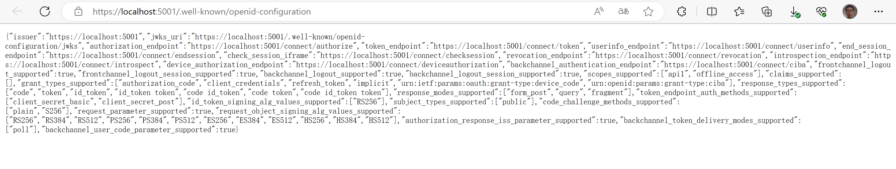
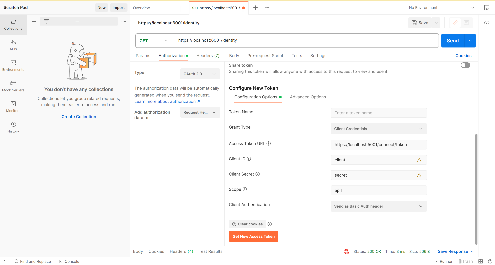
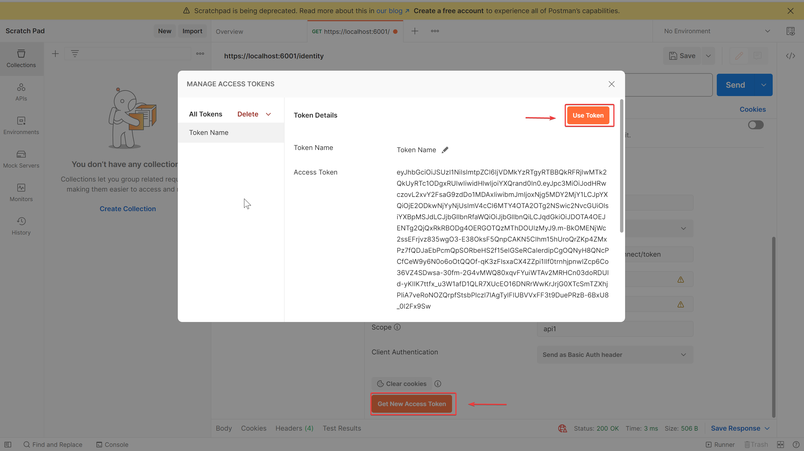
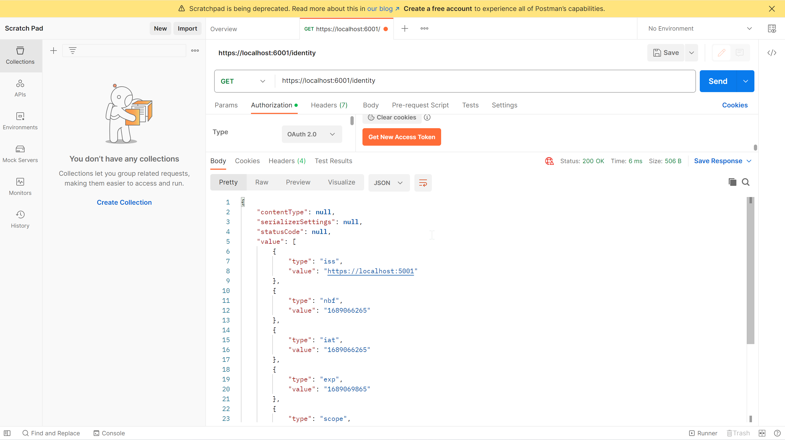

# IdentityServer实现Client Credential

## Create the Solution and IdentityServer Project

这个快速入门提供了逐步说明，以在最基本的情景中设置IdentityServer: 保护服务器间通信的API。您将创建一个包含三个项目的解决方案：
- 一个身份验证服务器
- 一个需要身份验证的API
- 访问该API的客户端

客户端将使用其客户端ID和密钥向IdentityServer请求访问令牌，然后使用该令牌来获取对API的访问权限。

### Defining an API Scope

范围是OAuth的核心功能，允许您表达访问的程度或范围。客户端在启动协议时请求范围，声明他们想要的访问范围。然后IdentityServer必须决定要在令牌中包含哪些范围。仅仅因为客户端请求了某些范围，并不意味着他们应该得到它！您可以使用内置抽象和可扩展性点来做出这个决定。最终，IdentityServer向客户端发放令牌，然后客户端使用令牌来访问API。API可以检查令牌中包含的范围以进行授权决策。

作用域没有由协议强制的结构 - 它们只是由空格分隔的字符串。这样设计系统使用的作用域时会更灵活。在这个快速入门中，您将创建一个代表对稍后在这个快速入门中创建的API的完全访问权限的作用域。

Scope配置如下：
```csharp
public static IEnumerable<ApiScope> ApiScopes =>  
	new List<ApiScope>  
	{  
		new ApiScope("api1", "My API")  
	};
```

### Defining the client

下一步是配置一个客户端应用程序，您将使用它来访问API。您将在本快速入门中稍后创建客户端应用程序项目。首先，您将为其添加配置到您的IdentityServer项目中。

在本快速入门中，客户端将没有交互式用户，并且将使用客户端密钥来进行身份验证。

Client配置如下：

```csharp
public static IEnumerable<Client> Clients =>
	new List<Client>
	{
		new Client
		{
			ClientId = "client",

			// no interactive user, use the clientid/secret for authentication
			AllowedGrantTypes = GrantTypes.ClientCredentials,

			// secret for authentication
			ClientSecrets =
			{
				new Secret("secret".Sha256())
			},

			// scopes that client has access to
			AllowedScopes = { "api1" }
		}
	};
```

参数声明一个ClientId，它标识了应用程序向IdentityServer进行连接的客户端。一个Secret，你可以将其视为客户端的密码。
还有客户端被允许请求的作用域列表。请注意，这里允许的作用域与上面的ApiScope的名称匹配。

### Configuring IdentityServer

范围和客户端定义加载在HostingExtensions.cs中。

```csharp
public static WebApplication ConfigureServices(this WebApplicationBuilder builder)  
{  
	// uncomment, if you want to add an MVC-based UI  
	// builder.Services.AddRazorPages();  
	  
	builder.Services.AddIdentityServer()  
	.AddInMemoryApiScopes(Config.ApiScopes)  
	.AddInMemoryClients(Config.Clients);  
	  
	return builder.Build();  
}

public static WebApplication ConfigurePipeline(this WebApplication app)  
{  
	// uncomment if you want to add a UI  
	//app.UseStaticFiles();  
	//app.UseRouting();  
	  
	app.UseSerilogRequestLogging();  
	if (app.Environment.IsDevelopment())  
	{  
	app.UseDeveloperExceptionPage();  
	}  
	app.UseIdentityServer();  
	  
	// uncomment, if you want to add a UI  
	//app.UseAuthorization();  
	//app.MapRazorPages().RequireAuthorization();  
	  
	return app;  
}
```

现在，你的IdentityServer已经配置完成。如果你运行项目并在浏览器中导航到https://localhost:5001/.well-known/openid-configuration，你应该能看到发现文档。发现文档是OpenID Connect和OAuth中的一个标准端点。它被你的客户端和API用于检索请求和验证令牌、登录和注销等所需的配置数据。


## Create an API Project

接下来，向您的解决方案中添加一个API项目。此API将提供受IdentityServer保护的资源。

### Add JWT Bearer Authentication

现在你将向API的ASP.NET管道中添加JWT承载身份验证。目标是使用IdentityServer项目发出的令牌授权对API进行调用。为此，您将从Microsoft.AspNetCore.Authentication.JwtBearer nuget软件包中向管道添加身份验证中间件。这个中间件将

- 查找并解析作为Authorization: Bearer头部发送的JWT。
- 验证JWT的签名，以确保它是由IdentityServer发布的。
- 验证JWT是否未过期。

现在将JWT Bearer身份验证服务添加到服务集合中，以允许依赖注入（DI），并将Bearer配置为默认的身份验证方案。

```csharp
builder.Services.AddAuthentication("Bearer")  
	.AddJwtBearer(options =>  
	{  
	options.Authority = "https://localhost:5001";  
	options.TokenValidationParameters.ValidateAudience = false;  
	});
```

在这里禁用了受众验证，因为对 API 的访问仅使用 ApiScopes 进行建模。默认情况下，除非使用 ApiResources 进行建模，否则不会生成任何受众。

### Add a controller

此控制器将用于测试授权并通过 API 的视角显示声明身份。

```csharp
[Route("identity")]  
[Authorize]  
public class IdentityController : ControllerBase  
{  
	[HttpGet]  
	public IActionResult Get()  
	{  
		return new JsonResult(from c in User.Claims select new { c.Type, c.Value });  
	}  
}
```

## Create the client project

最后的步骤是创建一个客户端，请求访问令牌，然后使用该令牌访问API。您的客户端将在解决方案中作为一个控制台项目。

IdentityServer的令牌端点实现了OAuth协议，您可以使用原始的HTTP来访问它。不过，我们有一个名为IdentityModel的客户端库，将协议交互封装在易于使用的API中。

### Retrieve the discovery document

IdentityModel包括一个用于与发现端点一起使用的客户端库。这样，您只需要知道IdentityServer的基本地址-实际的端点地址可以从元数据中读取。将以下内容添加到src/Client/Program.cs目录中的客户端的Program.cs文件中：

```csharp
// discover endpoints from metadata  
var client = new HttpClient();  
  
var disco = await client.GetDiscoveryDocumentAsync("https://localhost:5001");  
if (disco.IsError)  
{  
	Console.WriteLine(disco.Error);  
	return;  
}
```

### Request a token from IdentityServer

接下来，您可以使用发现文档中的信息向IdentityServer请求一个令牌，以访问api1。

```csharp
// request token  
	var tokenResponse = await client.RequestClientCredentialsTokenAsync(new ClientCredentialsTokenRequest  
	{  
		Address = disco.TokenEndpoint,  
		ClientId = "client",  
		ClientSecret = "secret",  
		  
		Scope = "api1"  
	});  
  
if (tokenResponse.IsError)  
{  
	Console.WriteLine(tokenResponse.Error);  
	Console.WriteLine(tokenResponse.ErrorDescription);  
	return;  
}  
  
Console.WriteLine(tokenResponse.Json);  
Console.WriteLine("\n\n");
```

### Calling the API

发送访问令牌给API通常使用HTTP授权标头。 使用SetBearerToken扩展方法来实现：

```csharp
// call api
var apiClient = new HttpClient();
apiClient.SetBearerToken(tokenResponse.AccessToken);

var response = await apiClient.GetAsync("https://localhost:6001/identity");
if (!response.IsSuccessStatusCode)
{
    Console.WriteLine(response.StatusCode);
}
else
{
    var doc = JsonDocument.Parse(await response.Content.ReadAsStringAsync()).RootElement;
    Console.WriteLine(JsonSerializer.Serialize(doc, new JsonSerializerOptions { WriteIndented = true }));
}
```

### Authorization at the API

现在，API接受由您的IdentityServer颁发的任何访问令牌。在本节中，您将向API添加一个授权策略，用于检查访问令牌中是否存在“api1”范围。协议确保仅当客户端请求该范围并且IdentityServer允许客户端拥有该范围时，该范围才会包含在令牌中。您通过将其包含在allowedScopes属性中来配置IdentityServer允许此访问。将以下内容添加到API的Program.cs文件的ConfigureServices方法中：

```csharp
builder.Services.AddAuthorization(options =>  
	options.AddPolicy("ApiScope", policy =>  
	{  
		policy.RequireAuthenticatedUser();  
		policy.RequireClaim("scope", "api1");  
	})  
);

app.MapControllers().RequireAuthorization("ApiScope");
```

### Postman测试

填写客户端信息，授权类型编写 `Client Credentials` 。 Client ID，Client Secret，Scope，按照注册客户端时候填写。Access Token URL 填写 为https://localhost:5001/connect/token。



获取Access Token



使用Access Token 访问保护资源。 返回用户的信息。


