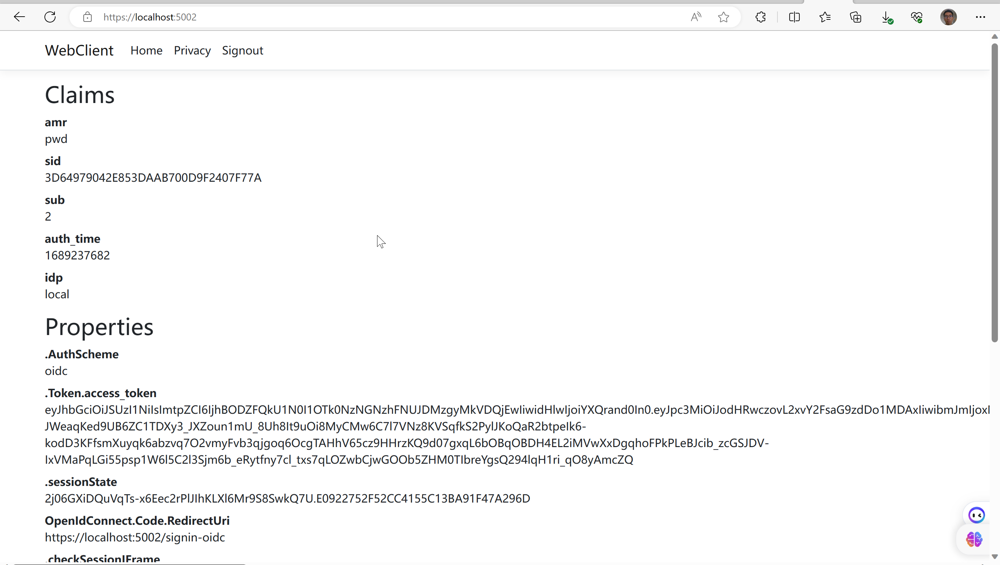
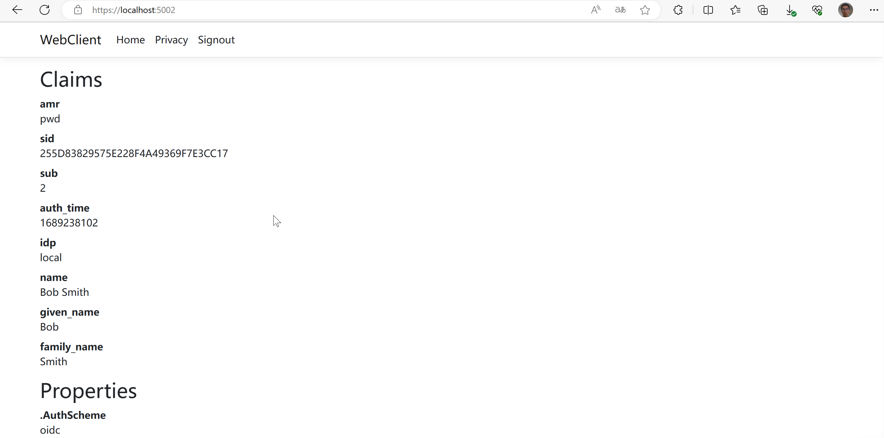
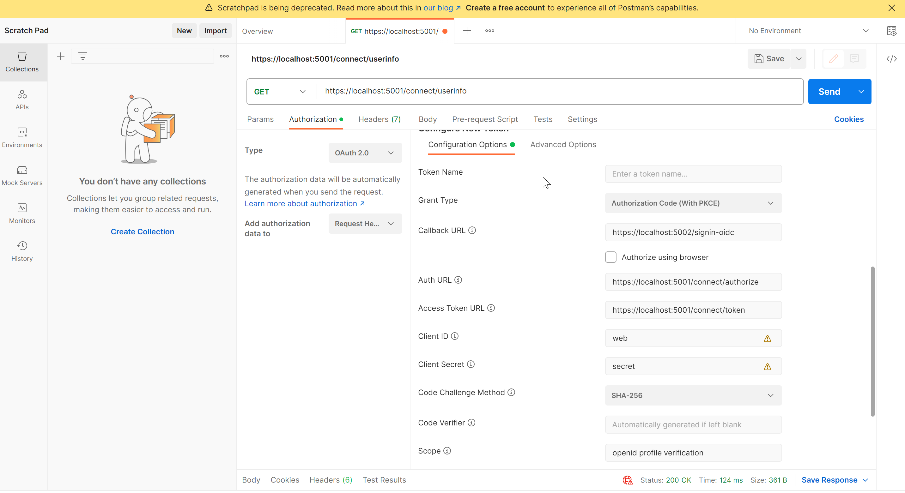
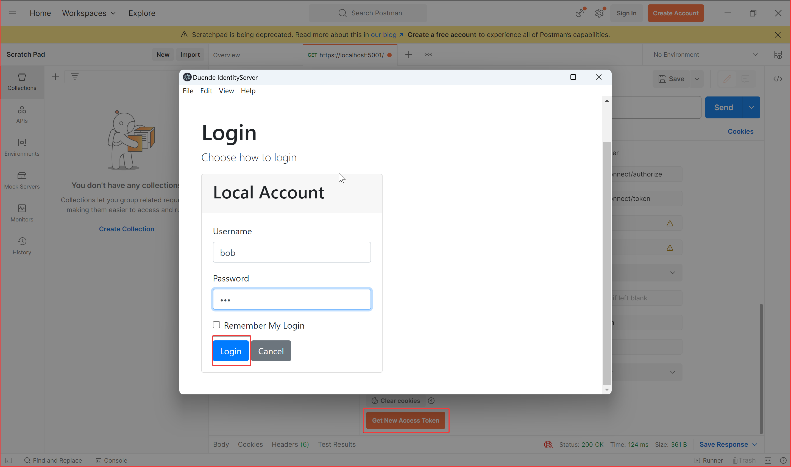
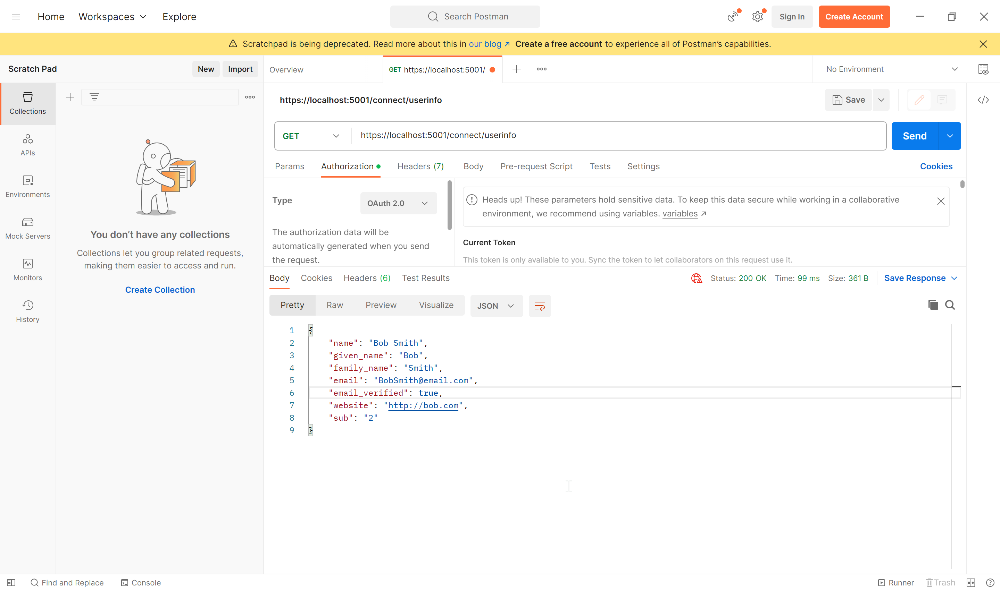

# IdentityServer实现Authorization Code 流程

在这个快速起步教程中，您将为您在快速起步1中构建的IdentityServer添加对OpenID Connect协议的交互式用户认证支持。一旦完成，您将创建一个ASP.NET Razor Pages应用程序，该应用程序将使用IdentityServer进行身份验证。

## Enable OIDC in IdentityServer

IdentityServer已经内置了对OpenID Connect协议的支持。您需要为登录、注销、同意和错误提供用户界面。

### Configure OIDC Scopes

与OAuth类似，OpenID Connect使用范围（scopes）来表示您想要保护的内容，客户端希望访问的内容。与OAuth不同的是，OIDC中的范围表示身份数据，如用户ID、姓名或电子邮件地址，而不是API。

在src/IdentityServer/Config.cs中声明它们，为标准的openid（主题id）和profile（名字、姓氏等）范围添加支持。

```csharp
public static IEnumerable<IdentityResource> IdentityResources =>
	new List<IdentityResource>
	{ 
		new IdentityResources.OpenId(),
		new IdentityResources.Profile(),
		new IdentityResource()
		{
			Name = "verification",
			UserClaims = new List<string> 
			{ 
				JwtClaimTypes.Email,
				JwtClaimTypes.EmailVerified
			}
		}
	};
```

然后在src/IdentityServer/HostingExtensions.cs中注册身份资源和测试用户。

```csharp
builder.Services.AddIdentityServer()  
	.AddInMemoryIdentityResources(Config.IdentityResources)  
	.AddInMemoryApiScopes(Config.ApiScopes)  
	.AddInMemoryClients(Config.Clients)  
	.AddTestUsers(TestUsers.Users);
```

### Register an OIDC client

IdentityServer项目的最后一步是为使用OIDC进行登录的客户端添加一个新的配置条目。您将注册其配置。基于OpenID Connect的客户端与我们在前一篇中添加的OAuth客户端非常相似。但由于OIDC中的流程始终是交互式的，我们需要向配置中添加一些重定向URL。

```csharp
 // interactive ASP.NET Core Web App
new Client
{
	ClientId = "web",
	ClientSecrets = { new Secret("secret".Sha256()) },

	AllowedGrantTypes = GrantTypes.Code,

	// where to redirect after login
	RedirectUris = { "https://localhost:5002/signin-oidc" },

	// where to redirect after logout
	PostLogoutRedirectUris = { "https://localhost:5002/signout-callback-oidc" },

	AllowedScopes = new List<string>
	{
		IdentityServerConstants.StandardScopes.OpenId,
		IdentityServerConstants.StandardScopes.Profile,
		"verification"
	}
}
```

## Create the OIDC client

接下来，您将创建一个ASP.NET Web应用程序，允许交互用户使用OIDC登录。为了为WebClient项目添加OpenID Connect身份验证的支持，您需要添加包含OpenID Connect处理程序`Microsoft.AspNetCore.Authentication.OpenIdConnect`的NuGet包。

### Configure Authentication Services

添加如下代码：

```csharp
builder.Services.AddAuthentication(options =>
    {
        options.DefaultScheme = "Cookies";
        options.DefaultChallengeScheme = "oidc";
    })
    .AddCookie("Cookies")
    .AddOpenIdConnect("oidc", options =>
    {
        options.Authority = "https://localhost:5001";

        options.ClientId = "web";
        options.ClientSecret = "secret";
        options.ResponseType = "code";

        options.Scope.Clear();
        options.Scope.Add("openid");
        options.Scope.Add("profile");
        options.Scope.Add("verification");
        options.ClaimActions.MapJsonKey("email_verified", "email_verified");
        options.GetClaimsFromUserInfoEndpoint = true;
        
        options.SaveTokens = true;
    });

	
	app.UseRouting(); 
	app.UseAuthentication(); 
	app.UseAuthorization(); 
	app.MapRazorPages().RequireAuthorization();
```

AddAuthentication 函数用于注册认证服务。注意，在其选项中，DefaultChallengeScheme 被设置为“oidc”，而 DefaultScheme 被设置为“Cookies”。当一个未认证的用户需要登录时，会使用 DefaultChallengeScheme。这会启动 OpenID Connect 协议，将用户重定向到 IdentityServer。在用户登录并被重定向回客户端后，客户端会创建自己的本地 cookie。随后对客户端的请求将包含此 cookie，并通过默认的 Cookie 方案进行身份验证。

AddOpenIdConnect用于配置执行OpenID Connect协议的处理程序。Authority指示可信任令牌服务的位置。ClientId和ClientSecret用于标识此客户端。Scope是客户端将请求的作用域集合。默认情况下，它包括openid和profile作用域，但可以清除集合并添加它们以明确清晰。SaveTokens用于在cookie中持久化令牌（因为稍后将需要使用它们）。将其设置为true表示在成功认证后,访问令牌和刷新令牌会被保存在AuthenticationProperties中。 这允许在请求的其他地方访问这些令牌的值。
我们会在后续页面中访问存储的令牌。

```
@page
@model IndexModel

@using Microsoft.AspNetCore.Authentication

<h2>Claims</h2>

<dl>
    @foreach (var claim in User.Claims)
    {
        <dt>@claim.Type</dt>
        <dd>@claim.Value</dd>
    }
</dl>

<h2>Properties</h2>

<dl>
    @foreach (var prop in (await HttpContext.AuthenticateAsync()).Properties.Items)
    {
        <dt>@prop.Key</dt>
        <dd>@prop.Value</dd>
    }
</dl>
```

最后在在src/WebClient/Program.cs中的ASP.NET管道中添加UseAuthentication。还要在MapRazorPages上链接一个调用RequireAuthorization来禁用整个应用程序的匿名访问。


## Test the client

现在一切都应该准备就绪，可以使用OIDC登录WebClient。运行IdentityServer和WebClient，然后通过访问受保护的主页触发认证握手。您应该会看到重定向到IdentityServer的登录页面。

在的登录界面输入配置好的用户bob，登录成功跳转回主页显示cookie信息。参数中`Properties.Token`有保存的`access_token`，`id_token`。




## Adding sign-out

为了登出，您需要：

- 清除本地应用程序的cookie
- 通过OIDC协议进行往返到IdentityServer来清除其会话

当您从身份验证方案中注销时，cookie auth处理程序会清除本地cookie。当您从其方案中注销时，OpenId Connect处理程序将执行与IdentityServer的往返协议步骤。


## Getting claims from the UserInfo endpoint

你可能注意到，即使你已经配置了客户端允许检索个人配置范围（profile identity scope），与该范围相关的声明（如姓名、姓氏、网站等）也不会出现在返回的令牌中。你需要告诉客户端从用户信息端点检索这些声明，方法是指定客户端应用程序需要访问的范围并设置GetClaimsFromUserInfoEndpoint选项。

```csharp
.AddOpenIdConnect("oidc", options =>
{
    // ...
    options.Scope.Clear();
    options.Scope.Add("openid");
    options.Scope.Add("profile");
    options.GetClaimsFromUserInfoEndpoint = true;
    // ...
});

```

在重新启动客户端应用程序，注销并重新登录后，您应该在页面上看到与配置文件身份范围相关的附加用户声明。



### Add More Claims

在src/IdentityServer/Config.cs文件中的列表中添加一个新的身份资源。为其命名，并指定在请求时应返回哪些声明。资源的Name属性是客户端可以请求以获取关联UserClaims的范围值。例如，您可以添加一个名为“verification”的IdentityResource，其中包括电子邮件和电子邮件验证的声明。

```csharp
  public static IEnumerable<IdentityResource> IdentityResources =>
  new List<IdentityResource>
  { 
      new IdentityResources.OpenId(),
      new IdentityResources.Profile(),
      new IdentityResource()
      {
          Name = "verification",
          UserClaims = new List<string> 
          { 
              JwtClaimTypes.Email,
              JwtClaimTypes.EmailVerified
          }
      }
  };

```

在src/IdentityServer/Config.cs的客户端配置中，通过AllowedScopes属性为客户端提供对资源的访问。AllowedScopes中的字符串值必须与资源的Name属性匹配。

```csharp
  new Client
  {
      ClientId = "web",
      //...
      AllowedScopes = new List<string>
      {
          IdentityServerConstants.StandardScopes.OpenId,
          IdentityServerConstants.StandardScopes.Profile,
          "verification"
      }
  }

```

请通过将其添加到src/WebClient/Program.cs中的OpenID Connect处理程序配置的Scopes集合来请求资源，并添加一个ClaimAction，将从userinfo终点返回的新claim映射到用户claim。

```csharp
  .AddOpenIdConnect("oidc", options =>
  {
      // ...
      options.Scope.Add("verification");
      options.ClaimActions.MapJsonKey("email_verified", "email_verified");
      // ...
  }

```

openidconnect的参数中配置了一些默认的options.ClaimActions.

- ClaimActions.MapJsonKey(ClaimTypes.NameIdentifier, JwtClaimTypes.Subject) - 将Subject声明映射到NameIdentifier声明
- ClaimActions.MapJsonKey(ClaimTypes.Name, JwtClaimTypes.Name) - 将Name声明映射到Name声明
- ClaimActions.MapJsonKey(ClaimTypes.GivenName, JwtClaimTypes.GivenName) - 将GivenName声明映射到GivenName声明
- ClaimActions.MapJsonKey(ClaimTypes.Surname, JwtClaimTypes.FamilyName) - 将FamilyName声明映射到Surname声明
- ClaimActions.MapJsonKey(ClaimTypes.Email, JwtClaimTypes.Email) - 将Email声明映射到Email声明
- ClaimActions.MapCustomJson(ClaimTypes.Role, JwtClaimTypes.Role) - 将Role数组声明自定义映射到单个Role声明
- ClaimActions.DeleteClaim(JwtClaimTypes.Expiration) - 删除Expiration声明
- ClaimActions.DeleteClaim(JwtClaimTypes.IssuedAt) - 删除IssuedAt声明
- ClaimActions.DeleteClaim(JwtClaimTypes.NotBefore) - 删除NotBefore声明
- ClaimActions.DeleteClaim(JwtClaimTypes.Nonce) - 删除Nonce声明

但是没有添加email_verified，所以需要添加一个.MapJsonKey("email_verified", "email_verified");

IdentityServer使用IProfileService来为令牌和userinfo端点检索声明。您可以提供自己的IProfileService的实现，以自定义该过程的逻辑、数据访问等。由于您正在使用AddTestUsers，因此将自动使用TestUserProfileService。它将自动包含在src/IdentityServer/TestUsers.cs中添加的测试用户请求的声明。

## postman测试

修改OAuth2.0认证的参数，Grant Type 为Authorization Code With PKCE，callback地址写我们客户端注册的回调地址，AuthUrl先默认的IdentityServer授权地址。Scope填写 openid profile verification



点击获取Access Token，跳转登录页面，输入账号密码之后跳转回调地址。



使用Access Token 调用userinfo endpoint。


