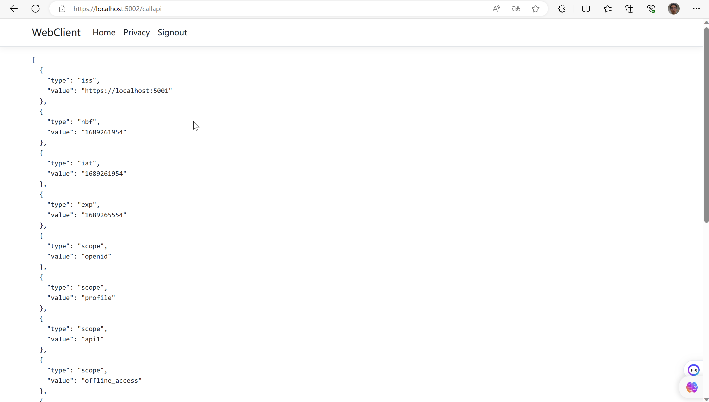

# IdentityServer同时实现认证和访问API

OpenID Connect和OAuth的结合非常简洁；您可以通过令牌服务在一次交互中实现用户认证和API访问。

在上一节中，登录过程中的令牌请求仅要求身份资源，即仅要求范围如个人资料和开放ID。在此快速入门中，您将在该请求中添加用于API资源的范围。IdentityServer将回复两个令牌：
- 身份令牌，包含了关于认证过程和会话的信息，并且
- 访问令牌，允许代表登录用户访问API。

## Modifying the client configuration

身份服务器中的客户端配置需要两个简单的更新。
- 将api1资源添加到允许的范围列表中，以便客户端具有访问权限。
- 通过设置AllowOfflineAccess标志启用对刷新令牌的支持。

### 为什么要设置 AllowOfflineAccess
- offline_access 作用是请求 refresh_token。refresh_token 是一个长期有效的 token,用于当 access_token 过期后,能够通过 refresh_token 来重新获取一个新的 access_token,而无需用户重新登录授权。
- 如果客户端需要能够在用户不在线的情况下,继续访问用户数据,那么就需要请求 offline_access 来获取 refresh_token。

```csharp
new Client
{
    ClientId = "web",
    ClientSecrets = { new Secret("secret".Sha256()) },

    AllowedGrantTypes = GrantTypes.Code,
            
    // where to redirect to after login
    RedirectUris = { "https://localhost:5002/signin-oidc" },

    // where to redirect to after logout
    PostLogoutRedirectUris = { "https://localhost:5002/signout-callback-oidc" },
    
    AllowOfflineAccess = true,

    AllowedScopes = new List<string>
    {
        IdentityServerConstants.StandardScopes.OpenId,
        IdentityServerConstants.StandardScopes.Profile,
        "api1"
    }
}

```


## Modifying the Web client

现在配置客户端请求api1的访问权限和离线访问令牌，方法是请求api1和offline_access范围。这在src/WebClient/Program.cs中的OpenID Connect处理程序配置中完成。

```csharp
builder.Services.AddAuthentication(options =>
{
    options.DefaultScheme = "Cookies";
    options.DefaultChallengeScheme = "oidc";
})
    .AddCookie("Cookies")
    .AddOpenIdConnect("oidc", options =>
    {
        options.Authority = "https://localhost:5001";

        options.ClientId = "web";
        options.ClientSecret = "secret";
        options.ResponseType = "code";

        options.SaveTokens = true;

        options.Scope.Clear();
        options.Scope.Add("openid");
        options.Scope.Add("profile");
        options.Scope.Add("api1");
        options.Scope.Add("offline_access");
        options.GetClaimsFromUserInfoEndpoint = true;
    });

```


## Using the access token

现在你将使用访问令牌来授权WebClient向Api发送请求。

将src/WebClient/Pages/CallApi.cshtml.cs的内容按照以下方式更新：

```csharp
public class CallApiModel : PageModel
{
    public string Json = string.Empty;

    public async Task OnGet()
    {
        var accessToken = await HttpContext.GetTokenAsync("access_token");
        var client = new HttpClient();
        client.DefaultRequestHeaders.Authorization = new AuthenticationHeaderValue("Bearer", accessToken);
        var content = await client.GetStringAsync("https://localhost:6001/identity");

        var parsed = JsonDocument.Parse(content);
        var formatted = JsonSerializer.Serialize(parsed, new JsonSerializerOptions { WriteIndented = true });

        Json = formatted;
    }
}

```

确保 IdentityServer 和 Api 项目正在运行，启动 WebClient 并在身份验证后请求 /CallApi。



## 保护API几种方式

### 通过JWT保护

在上述案例中，我们只关心确保访问令牌来自您信任的IdentityServer。JWT的配置如下。

```csharp
public class Startup
{
    public void ConfigureServices(IServiceCollection services)
    {
        services.AddAuthentication(JwtBearerDefaults.AuthenticationScheme)
            .AddJwtBearer(options =>
            {
                // base-address of your identityserver
                options.Authority = "https://demo.duendesoftware.com";

                // audience is optional, make sure you read the following paragraphs
                // to understand your options
                options.TokenValidationParameters.ValidateAudience = false;

                // it's recommended to check the type header to avoid "JWT confusion" attacks
                options.TokenValidationParameters.ValidTypes = new[] { "at+jwt" };
            });
    }
}

```

### 通过audience验证

仅仅确保令牌来自受信任的发行者对于大多数情况来说并不足够。在更复杂的系统中，您将拥有多个资源和多个客户端。并非每个客户端都有权限访问每个资源。

在OAuth中，有两种互补的机制可以嵌入有关令牌的“功能性”更多信息 - audience和scope。

如果您根据API资源的概念设计了您的API，您的IdentityServer将默认发出aud声明（在此示例中为api1）。

```json
{
    "typ": "at+jwt",
    "kid": "123"
}.
{
    "aud": "api1",

    "client_id": "mobile_app",
    "sub": "123",
    "scope": "read write delete"
}

```

### 通过scope的授权

访问令牌将包括用于授权的附加声明，例如范围声明将反映客户端在令牌请求期间请求的（并且已被授予的）范围。

在ASP.NET core中，JWT负载的内容会转换为声明，并打包在ClaimsPrincipal中。为了更好地封装和重用，使用ASP.NET Core授权策略功能。使用此方法，首先将声明要求转化为命名策略：

```csharp
builder.Services.AddAuthorization(options =>  
	options.AddPolicy("ApiScope", policy =>  
	{  
		policy.RequireAuthenticatedUser();  
		policy.RequireClaim("scope", "api1");  
	})  
);
```

...然后强制执行它，例如使用路由表：

```csharp
app.MapControllers().RequireAuthorization("ApiScope");
```

### Scope声明格式

历史上，Duende IdentityServer在JWT中将作用域声明作为数组发出。此方法在.NET反序列化逻辑中非常有效，它将每个数组项转换为类型为scope的单独的声明。

较新的OAuth规范中的JWT配置要求scope声明是一个用空格分隔的字符串。您可以通过在选项中设置EmitScopesAsSpaceDelimitedStringInJwt来更改格式。但这意味着使用访问令牌的代码可能需要进行调整。

可以安装包：

```
dotnet package add IdentityModel.AspNetCore.AccessTokenValidation
```

在程序配置服务如下：

```csharp
builder.Services.AddScopeTransformation();


