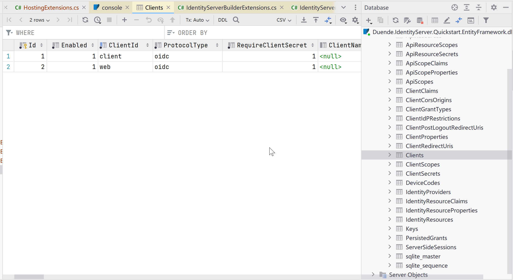

# IdentityServer使用entityframeworkcore存储配置

在之前的快速入门中，您使用代码配置了客户端和范围。IdentityServer在启动时将此配置数据加载到内存中。要修改配置，需要重新启动。IdentityServer还会生成临时数据，例如授权码、同意选择和刷新令牌。在快速入门的这一点上，此数据也存储在内存中。

为了将这些数据移动到在重启之间保持持久性并可在多个IdentityServer实例间访问的数据库中，您将使用Duende.IdentityServer.EntityFramework库。

## Configure IdentityServer

### Install Duende.IdentityServer.EntityFramework

IdentityServer的Entity Framework集成由Duende.IdentityServer.EntityFramework NuGet包提供。从src/IdentityServer目录下运行以下命令进行安装:

```
dotnet add package Duende.IdentityServer.EntityFramework

```

### Install Microsoft.EntityFrameworkCore.Sqlite

Duende.IdentityServer.EntityFramework 可以与任何 Entity Framework 数据库提供程序一起使用。在这个快速入门中，您将使用 Sqlite。要将 Sqlite 支持添加到您的 IdentityServer 项目中，请通过从 src/IdentityServer 目录运行以下命令来安装 Entity Framework Sqlite NuGet 包:

```
dotnet add package Microsoft.EntityFrameworkCore.Sqlite
```

### Configuring the Stores

Duende.IdentityServer.EntityFramework将配置和操作数据分别存储在不同的存储区中，每个存储区都有自己的DbContext。

- ConfigurationDbContext: 用于存储配置数据，例如客户端、资源和作用域
- PersistedGrantDbContext: 用于存储动态操作数据，例如授权码和刷新令牌

要使用这些存储区，您需要在src/IdentityServer/HostingExtensions.cs的ConfigureServices方法中，将现有的AddInMemoryClients、AddInMemoryIdentityResources和AddInMemoryApiScopes调用替换为AddConfigurationStore和AddOperationalStore，例如：

```csharp
public static WebApplication ConfigureServices(this WebApplicationBuilder builder)
{
    var migrationsAssembly = typeof(Program).Assembly.GetName().Name;
    const string connectionString = @"Data Source=Duende.IdentityServer.Quickstart.EntityFramework.db";

    builder.Services.AddIdentityServer()
        .AddConfigurationStore(options =>
        {
            options.ConfigureDbContext = b => b.UseSqlite(connectionString,
                sql => sql.MigrationsAssembly(migrationsAssembly));
        })
        .AddOperationalStore(options =>
        {
            options.ConfigureDbContext = b => b.UseSqlite(connectionString,
                sql => sql.MigrationsAssembly(migrationsAssembly));
        })
        .AddTestUsers(TestUsers.Users);
    
    //...
}

```

## Managing the Database Schema

“Duende.IdentityServer.EntityFramework.Storage” NuGet软件包（作为Duende.IdentityServer.EntityFramework的依赖项安装）包含实体类，这些类映射到IdentityServer的模型上。这些实体与IdentityServer的模型保持同步 - 当模型在新版本中更改时，对应的实体也会进行更改。随着您在使用IdentityServer时逐渐升级，您需要负责自己的数据库模式并进行必要的更改。

管理这些更改的一种方法是使用EF迁移，这就是本快速入门将使用的方式。如果您不喜欢使用迁移，则可以按照您认为合适的方式管理模式更改。

### Adding Migrations

要创建迁移，您需要在您的计算机上安装Entity Framework Core CLI工具和IdentityServer中的Microsoft.EntityFrameworkCore.Design NuGet软件包。从src/IdentityServer目录下运行以下命令：

```
dotnet tool install --global dotnet-ef
dotnet add package Microsoft.EntityFrameworkCore.Design
```

现在从src/IdentityServer目录下运行以下两个命令来创建迁移：

```
dotnet ef migrations add InitialIdentityServerPersistedGrantDbMigration -c PersistedGrantDbContext -o Data/Migrations/IdentityServer/PersistedGrantDb
dotnet ef migrations add InitialIdentityServerConfigurationDbMigration -c ConfigurationDbContext -o Data/Migrations/IdentityServer/ConfigurationDb
```

现在您应该在项目中看到一个src/IdentityServer/Data/Migrations/IdentityServer目录，其中包含您新创建的迁移代码。

### Initializing the Database

现在你已经有了迁移文件，你可以编写代码来从迁移文件创建数据库，并使用相同的配置数据来填充数据库，就像之前的快速入门示例一样。

"在src/IdentityServer/HostingExtensions.cs中，添加以下方法以初始化数据库："

```csharp
private static void InitializeDatabase(IApplicationBuilder app)
{
    using (var serviceScope = app.ApplicationServices.GetService<IServiceScopeFactory>().CreateScope())
    {
        serviceScope.ServiceProvider.GetRequiredService<PersistedGrantDbContext>().Database.Migrate();

        var context = serviceScope.ServiceProvider.GetRequiredService<ConfigurationDbContext>();
        context.Database.Migrate();
        if (!context.Clients.Any())
        {
            foreach (var client in Config.Clients)
            {
                context.Clients.Add(client.ToEntity());
            }
            context.SaveChanges();
        }

        if (!context.IdentityResources.Any())
        {
            foreach (var resource in Config.IdentityResources)
            {
                context.IdentityResources.Add(resource.ToEntity());
            }
            context.SaveChanges();
        }

        if (!context.ApiScopes.Any())
        {
            foreach (var resource in Config.ApiScopes)
            {
                context.ApiScopes.Add(resource.ToEntity());
            }
            context.SaveChanges();
        }
    }
}

```

从ConfigurePipeline方法中调用InitializeDatabase。

```csharp
public static WebApplication ConfigurePipeline(this WebApplication app)
{ 
    app.UseSerilogRequestLogging();
    if (app.Environment.IsDevelopment())
    {
        app.UseDeveloperExceptionPage();
    }
    
    InitializeDatabase(app);
    
    //...
}
```


现在，如果你运行IdentityServer项目，数据库应该会被创建，并且用快速配置数据填充。你可以使用类似SQL Lite Studio的工具连接和检查数据。



