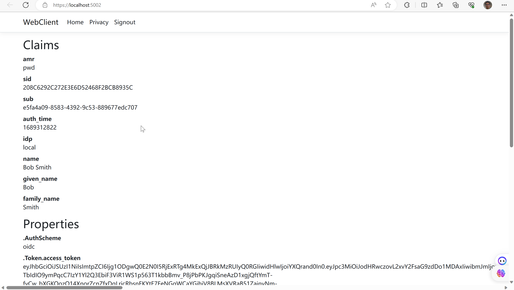

# IdentityServer结合ASP.NET Core Identity

IdentityServer的灵活设计允许您使用任何数据库来存储用户及其数据，包括密码哈希、多因素身份验证详细信息、角色、声明、个人资料数据等。如果您从头开始创建一个新的用户数据库，那么ASP.NET Core Identity就是一个可选的选择。本快速入门将展示如何在IdentityServer中使用ASP.NET Core Identity。

## New Project for ASP.NET Core Identity

第一步是为您的解决方案添加一个新的ASP.NET Core Identity项目。我们提供了一个模板，其中包含使用IdentityServer的ASP.NET Core Identity所需的最小UI资源。

### 配置

在ConfigureServices中，注意需要使用AddDbContext()和AddIdentity<ApplicationUser, IdentityRole>()函数来配置ASP.NET Core身份验证工具。

```csharp
builder.Services.AddDbContext<ApplicationDbContext>(options =>  
options.UseSqlite(builder.Configuration.GetConnectionString("DefaultConnection")));  
  
builder.Services.AddIdentity<ApplicationUser, IdentityRole>()  
.AddEntityFrameworkStores<ApplicationDbContext>()  
.AddDefaultTokenProviders();
```

该模板使用内存方式来定义在Config.cs中的客户端和资源。

```csharp
builder.Services  
.AddIdentityServer(options =>  
{  
	options.Events.RaiseErrorEvents = true;  
	options.Events.RaiseInformationEvents = true;  
	options.Events.RaiseFailureEvents = true;  
	options.Events.RaiseSuccessEvents = true;  
	  
	// see https://docs.duendesoftware.com/identityserver/v6/fundamentals/resources/  
	options.EmitStaticAudienceClaim = true;  
})  
.AddInMemoryIdentityResources(Config.IdentityResources)  
.AddInMemoryApiScopes(Config.ApiScopes)  
.AddInMemoryClients(Config.Clients)  
.AddAspNetIdentity<ApplicationUser>();
```

最后，注意新增对AddAspNetIdentity()方法的调用。AddAspNetIdentity()方法将集成层添加到IdentityServer中，以便让IdentityServer能够访问ASP.NET Core Identity用户数据库中的用户数据。在需要为用户添加令牌中声明时，这就是必需的。

`RaiseErrorEvents` ，`RaiseInformationEvents` ，`RaiseFailureEvents`和`RaiseSuccessEvents`这些方法其实配置log日志输出的。在很多关键节点会抛出事件，默认的接受事件的事件就是写日志。

`options.EmitStaticAudienceClaim = true;` 这在access_token中将以issuer_name/resources格式发出aud声明。如：`"aud": "https://localhost:5001/resources"`。

请注意，在调用AddIdentityServer()之前必须先调用AddIdentity<ApplicationUser，IdentityRole>().

### Initializing the Database

现在你已经有了迁移文件，你可以编写代码来从迁移文件创建数据库，并使用相同的配置数据来填充数据库，就像之前的快速入门示例一样。

```csharp
app.UseSerilogRequestLogging();  
  
if (app.Environment.IsDevelopment())  
{  
	app.UseDeveloperExceptionPage();  
}  
  
SeedData.EnsureSeedData(app);  
  
app.UseStaticFiles();  
app.UseRouting();
```

注意配置文件中为了符合Identity的规范，不能使用bob这样的密码了。使用更安全的密码Pass123$

### 登录流程查看

最后，请查看src / IdentityServerAspNetIdentity / Pages / Account目录中的页面。这些页面包含与之前的快速入门和模板稍微不同的登录和注销代码，因为登录和注销过程现在依赖于ASP.NET Core Identity。请注意使用来自ASP.NET Core Identity的SignInManager和UserManager类型来验证凭据并管理身份验证会话。

从之前的快速入门和模板中的其余大部分代码都是相同的。

## Logging in with the Web client

到这一步，你应该能够运行所有的现有客户端和示例。启动Web客户端应用程序，你应该会被重定向到IdentityServer以登录。使用种子过程创建的用户之一登录（例如，alice/Pass123$），然后你将会被重定向回Web客户端应用程序，在那里你的用户声明应该会被列出。




## Adding Custom Profile Data

接下来，您将向用户模型添加自定义属性，并在请求适当的身份资源时将其作为声明包含在内。

首先，在ApplicationUser类中添加一个FavoriteColor属性。

```csharp
public class ApplicationUser : IdentityUser
{
    public string FavoriteColor { get; set; }
}
```

然后，在SeedData.cs中设置其中一个测试用户的FavoriteColor。

```csharp
alice = new ApplicationUser
{
    UserName = "alice",
    Email = "AliceSmith@email.com",
    EmailConfirmed = true,
    FavoriteColor = "red",
};
```

接下来，在CustomProfileData上创建一个ef migration，并重新填充用户数据库。从src/IdentityServerAspNetIdentity目录运行以下命令：

```
dotnet ef migrations add CustomProfileData
dotnet run /seed
```

现在数据库中有更多的数据，您可以使用这些数据来设置声明。IdentityServer 包含一个名为 IProfileService 的扩展点，负责检索用户声明。ASP.NET Identity 集成包括一个实现了 IProfileService 接口的实现，从 ASP.NET Identity 中检索声明。您可以扩展该实现，将自定义配置文件数据作为声明数据的源。

创建一个名为CustomProfileService的新类，并将以下代码添加到其中：

```csharp
using Duende.IdentityServer.AspNetIdentity;
using Duende.IdentityServer.Models;
using IdentityServerAspNetIdentity.Models;
using Microsoft.AspNetCore.Identity;
using System.Security.Claims;

namespace IdentityServerAspNetIdentity
{
    public class CustomProfileService : ProfileService<ApplicationUser>
    {
        public CustomProfileService(UserManager<ApplicationUser> userManager, IUserClaimsPrincipalFactory<ApplicationUser> claimsFactory) : base(userManager, claimsFactory)
        {
        }

        protected override async Task GetProfileDataAsync(ProfileDataRequestContext context, ApplicationUser user)
        {
            var principal = await GetUserClaimsAsync(user);
            var id = (ClaimsIdentity)principal.Identity;
            if (!string.IsNullOrEmpty(user.FavoriteColor))
            {
                id.AddClaim(new Claim("favorite_color", user.FavoriteColor));
            }

            context.AddRequestedClaims(principal.Claims);
        }
    }
}

```

在HostingExtensions.cs中注册CustomProfileService:

```csharp
builder.Services
    .AddIdentityServer(options =>
    {
        // ...
    })
    .AddInMemoryIdentityResources(Config.IdentityResources)
    .AddInMemoryApiScopes(Config.ApiScopes)
    .AddInMemoryClients(Config.Clients)
    .AddAspNetIdentity<ApplicationUser>()
    .AddProfileService<CustomProfileService>();

```

最后，您需要配置您的应用程序以请求favorite_color，并在客户端的配置中包含该声明。

在src/IdentityServerAspNetIdentity/Config.cs中添加一个新的IdentityResource，将颜色范围映射到favorite_color声明类型上。

```csharp
public static IEnumerable<IdentityResource> IdentityResources =>
    new IdentityResource[]
    {
        new IdentityResources.OpenId(),
        new IdentityResources.Profile(),
        new IdentityResource("color", new [] { "favorite_color" })
    };

```

允许Web客户端请求颜色范围（也在Config.cs中）。

```csharp
new Client
{
    ClientId = "web",
    // ...
    
    AllowedScopes = new List<string>
    {
        IdentityServerConstants.StandardScopes.OpenId,
        IdentityServerConstants.StandardScopes.Profile,
        "api1",
        "color"
    }
}

```

最后，更新WebClient项目，以便它请求颜色范围。在其src/WebClient/Program.cs文件中，将颜色范围添加到所请求的范围，并添加一个声明操作来将favorite_color映射到主体中：

```csharp
.AddOpenIdConnect("oidc", options =>
{
    // ...

    options.Scope.Clear();
    options.Scope.Add("openid");
    options.Scope.Add("profile");
    options.Scope.Add("offline_access");
    options.Scope.Add("api1");
    options.Scope.Add("color");

    options.GetClaimsFromUserInfoEndpoint = true;
    options.ClaimActions.MapUniqueJsonKey("favorite_color", "favorite_color");
});

```

现在重新启动IdentityServerAspNetIdentity和WebClient项目，登出然后再次登录为alice，您应该可以看到最喜欢的颜色声明。