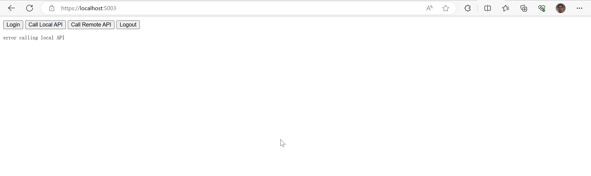
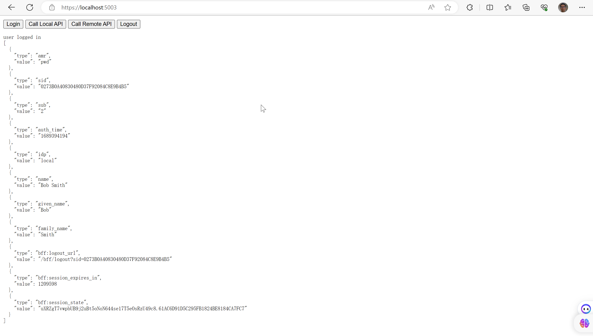
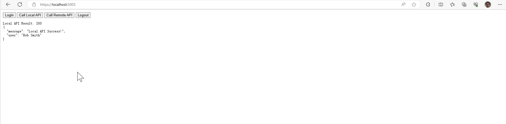
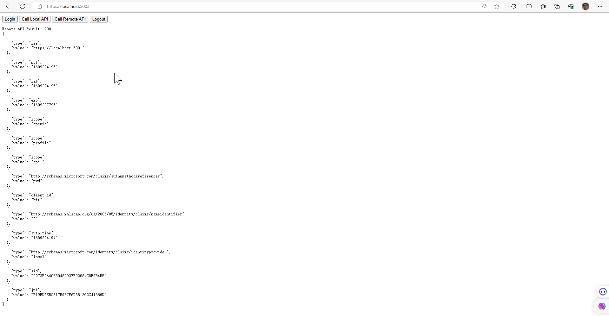

# 具有后端服务的javascript应用

构建JavaScript（或SPA）应用程序时，有两种主要的风格：具有后端和没有后端的风格。

具有后端的JavaScript应用程序更安全，这是首选风格。这种风格使用“Backend For Frontend”（简称BFF）模式，依赖于后端主机来实现与令牌服务器的所有安全协议交互。本快速入门使用Duende.BFF库来轻松支持BFF模式。

没有后端的JavaScript应用程序需要在客户端进行所有的安全协议交互，包括用户身份验证和令牌请求、会话和令牌管理以及令牌存储。这导致JavaScript更加复杂，跨浏览器不兼容性增加，攻击面也更大。由于这种风格固有地需要将安全敏感的内容（如令牌）存储在JavaScript可访问的位置，因此不鼓励在处理敏感数据的应用程序中使用这种风格。

在这个快速入门中，您将构建一个具有后端支持的基于浏览器的JavaScript客户端应用程序。这意味着您的应用程序将具有支持前端应用程序代码的服务器端代码。这被称为前端后端模式（Backend For Frontend，简称BFF）。

您将使用Duende.BFF库来实现BFF模式。后端将负责与令牌服务器进行所有安全协议的交互，并负责令牌的管理。客户端的JavaScript使用传统的cookie认证与BFF进行身份验证。这简化了客户端JavaScript的代码，并减少了应用程序的攻击面。

在此快速入门中将展示以下功能：用户可以使用IdentityServer进行登录，调用后端托管的本地API（通过cookie身份验证进行保护），调用在不同主机上运行的远程API（通过访问令牌进行保护），以及注销IdentityServer。

## New Project for the JavaScript client and BFF

首先，创建一个新项目来托管JavaScript应用程序和其BFF（Backend for Frontend）。将前端和其BFF放在同一个主机上的单个项目可以方便地进行cookie身份验证-前端和BFF需要在同一主机上，这样才能将cookie从前端发送到BFF。

### Add additional NuGet packages

通过从src/ JavaScriptClient目录运行以下命令，安装NuGet软件包以向新项目添加BFF和OIDC支持：

```
dotnet add package Microsoft.AspNetCore.Authentication.OpenIdConnect
dotnet add package Duende.BFF
dotnet add package Duende.BFF.Yarp
```

### Add services

在BFF模式中，服务器端的代码触发并接收OpenID Connect的请求和响应。为了做到这一点，它需要与WebClient在之前的Web应用快速入门中进行相同的服务配置。此外，还需要使用AddBff()添加BFF服务。

```csharp
using System.IdentityModel.Tokens.Jwt;
using System.Security.Claims;
using Duende.Bff.Yarp;
using Microsoft.AspNetCore.Authorization;

var builder = WebApplication.CreateBuilder(args);

builder.Services.AddAuthorization();

builder.Services
    .AddBff()
    .AddRemoteApis();

JwtSecurityTokenHandler.DefaultMapInboundClaims = false;
builder.Services
    .AddAuthentication(options =>
    {
        options.DefaultScheme = "Cookies";
        options.DefaultChallengeScheme = "oidc";
        options.DefaultSignOutScheme = "oidc";
    })
    .AddCookie("Cookies")
    .AddOpenIdConnect("oidc", options =>
    {
        options.Authority = "https://localhost:5001";
        options.ClientId = "bff";
        options.ClientSecret = "secret";
        options.ResponseType = "code";
        options.Scope.Add("api1");
        options.SaveTokens = true;
        options.GetClaimsFromUserInfoEndpoint = true;
    });

var app = builder.Build();

```

### Add middleware

同样，该应用程序的中间件管道将类似于WebClient，除了添加了BFF中间件和BFF端点。接下来，在src/JavaScriptClient/Program.cs中添加以下内容：

```csharp
var app = builder.Build();

if (app.Environment.IsDevelopment())
{
    app.UseDeveloperExceptionPage();
}

app.UseDefaultFiles();
app.UseStaticFiles();

app.UseRouting();
app.UseAuthentication();

app.UseBff();

app.UseAuthorization();

app.UseEndpoints(endpoints =>
{
    endpoints.MapBffManagementEndpoints();
});

app.Run();

```

### Add your HTML and JavaScript files

首先，在JavaScriptClient项目的wwwroot目录下添加HTML和JavaScript文件作为客户端应用。创建该目录（src/JavaScriptClient/wwwroot），然后在该目录下添加一个index.html文件和一个app.js文件。

index.html

```html
<!DOCTYPE html>
<html>
<head>
    <meta charset="utf-8" />
    <title></title>
</head>
<body>
    <button id="login">Login</button>
    <button id="local">Call Local API</button>
    <button id="remote">Call Remote API</button>
    <button id="logout">Logout</button>

    <pre id="results"></pre>

    <script src="app.js"></script>
</body>
</html>

```

app.js

app.js文件将包含您的应用程序的客户端代码。

接下来，您可以使用BFF用户管理端点查询用户是否已登录。注意，userClaims变量是全局的；它将在其他地方使用。

```js
let userClaims = null;

(async function () {
  var req = new Request("/bff/user", {
    headers: new Headers({
      "X-CSRF": "1",
    }),
  });

  try {
    var resp = await fetch(req);
    if (resp.ok) {
      userClaims = await resp.json();

      log("user logged in", userClaims);
    } else if (resp.status === 401) {
      log("user not logged in");
    }
  } catch (e) {
    log("error checking user status");
  }
})();

```

接下来，在按钮上注册点击事件处理程序：

```js
document.getElementById("login").addEventListener("click", login, false);
document.getElementById("local").addEventListener("click", localApi, false);
document.getElementById("remote").addEventListener("click", remoteApi, false);
document.getElementById("logout").addEventListener("click", logout, false);

```

登录操作很简单 - 只需将用户重定向到BFF登录终点。

```js
function login() {
  window.location = "/bff/login";
}
```

注销比较复杂，因为您需要重定向用户到BFF注销端点，该端点需要一个反跨站点请求伪造令牌来防止跨站请求伪造攻击。您之前填充的用户声明包含该令牌和完整的注销URL在其bff:logout_url声明中，所以重定向到该URL：

```js
function logout() {
  if (userClaims) {
    var logoutUrl = userClaims.find(
      (claim) => claim.type === "bff:logout_url"
    ).value;
    window.location = logoutUrl;
  } else {
    window.location = "/bff/logout";
  }
}
```

## Add a client registration to IdentityServer for the JavaScript client

现在客户端应用程序已经准备就绪，你需要在IdentityServer中为新的JavaScript客户端定义一个配置项。

在IdentityServer项目中，定位src/IdentityServer/Config.cs中的客户端配置。为你的新JavaScript应用程序在列表中添加一个新的Client。由于这个客户端使用BFF模式，配置将非常类似于Web客户端。它应该具有下面列出的配置：

```csharp
// JavaScript BFF client
new Client
{
    ClientId = "bff",
    ClientSecrets = { new Secret("secret".Sha256()) },

    AllowedGrantTypes = GrantTypes.Code,
    
    // where to redirect to after login
    RedirectUris = { "https://localhost:5003/signin-oidc" },

    // where to redirect to after logout
    PostLogoutRedirectUris = { "https://localhost:5003/signout-callback-oidc" },

    AllowedScopes = new List<string>
    {
        IdentityServerConstants.StandardScopes.OpenId,
        IdentityServerConstants.StandardScopes.Profile,
        "api1"
    }
}

```

## Run and test login and logout

在这个阶段，你应该可以运行JavaScriptClient应用程序。你应该能看到用户最初没有登录。




当您点击登录按钮时，您将被重定向到IdentityServer进行登录。登录成功后，您将被重定向回JavaScriptClient应用程序，您将被以Cookies身份验证方案登录，并将您的令牌保存在会话中。

应用程序再次加载，但这次它有一个会话cookie。因此，当它发送HTTP请求获取用户声明时，该cookie将包含在请求中。这使得BFF中间件能够对用户进行身份验证并返回用户信息。一旦JavaScriptClient应用程序接收到响应，用户应该显示为已登录，并显示其声明信息。



最后，注销按钮应该成功使用户注销。


## Add API support

现在，您已经实现了登录和注销功能，接下来您将添加对本地和远程API进行调用的支持。

本地API是在与JavaScriptClient应用程序相同后端托管的端点。本地API旨在为JavaScript前端提供支持，通常通过提供UI特定数据或从其他来源聚合数据来实现。本地API使用用户的会话cookie进行身份验证。

远程API是在与JavaScriptClient应用程序不同的主机上运行的API。这对于许多不同应用程序共享的API（例如移动应用程序、其他Web应用程序等）非常有用。远程API使用访问令牌进行身份验证。幸运的是，JavaScriptClient应用程序已经在用户的会话中存储了访问令牌。您将使用BFF代理功能接受浏览器中运行的JavaScript的调用，该调用使用用户的会话cookie进行身份验证，从用户的会话中检索用户的访问令牌，然后将调用代理到远程API，发送访问令牌进行身份验证。

### Define a local API

本地 API 可以使用控制器或最小 API 路由处理程序来定义。为了简单起见，此快速入门使用最小 API，并直接在 Program.cs 中定义其处理程序，但您可以根据自己的喜好组织本地 API。

在 src/JavaScriptClient/Program.cs 中添加一个处理程序来处理本地 API：

```csharp
[Authorize] 
static IResult LocalIdentityHandler(ClaimsPrincipal user)
{
    var name = user.FindFirst("name")?.Value ?? user.FindFirst("sub")?.Value;
    return Results.Json(new { message = "Local API Success!", user = name });
}
```

### Update routing to accept local and remote API calls

接下来，您需要在 ASP.NET Core 路由系统中注册本地 API 和远程 API 的 BFF 代理。将下面的代码添加到 src/JavaScriptClient/Program.cs 中的 UseEndpoints 调用中。

```csharp
app.UseEndpoints(endpoints =>
{
    endpoints.MapBffManagementEndpoints();

    // Uncomment this for Controller support
    // endpoints.MapControllers()
    //     .AsBffApiEndpoint();

    endpoints.MapGet("/local/identity", LocalIdentityHandler)
        .AsBffApiEndpoint();

    endpoints.MapRemoteBffApiEndpoint("/remote", "https://localhost:6001")
        .RequireAccessToken(Duende.Bff.TokenType.User);

});

```

调用AsBffApiEndpoint()流式助手方法，可以为本地API添加BFF支持。这包括反伪造保护，以及在认证失败时禁止登录重定向，而是根据具体情况返回401和403状态码。

MapRemoteBffApiEndpoint()注册远程API的BFF代理，并配置它传递用户的访问令牌。


### Call the APIs from JavaScript

回到src/JavaScriptClient/wwwroot/app.js，在这里实现两个API按钮事件处理程序：

```javascript
async function localApi() {
  var req = new Request("/local/identity", {
    headers: new Headers({
      "X-CSRF": "1",
    }),
  });

  try {
    var resp = await fetch(req);

    let data;
    if (resp.ok) {
      data = await resp.json();
    }
    log("Local API Result: " + resp.status, data);
  } catch (e) {
    log("error calling local API");
  }
}

async function remoteApi() {
  var req = new Request("/remote/identity", {
    headers: new Headers({
      "X-CSRF": "1",
    }),
  });

  try {
    var resp = await fetch(req);

    let data;
    if (resp.ok) {
      data = await resp.json();
    }
    log("Remote API Result: " + resp.status, data);
  } catch (e) {
    log("error calling remote API");
  }
}
```

本地 API 的路径与在 src/JavaScriptClient/Program.cs 中对 MapGet 的调用完全一致。

远程 API 的路径使用“/remote”前缀表示应该使用 BFF 代理，剩下的路径是在调用远程 API 时传递的（在本例中为“/identity”）。

注意，这两个 API 调用都需要一个名为‘X-CSRF’: ‘1’的头部，它充当防伪标记。

## Run and test the API calls

到此为止，您应该能够运行JavaScriptClient应用程序并调用API。本地API应该返回类似于以下内容：



并且远程API应该返回类似这样的结果：



您现在拥有一个使用IdentityServer进行登录、注销以及通过Duende.BFF验证本地和远程API调用的JavaScript客户端应用程序的起点。