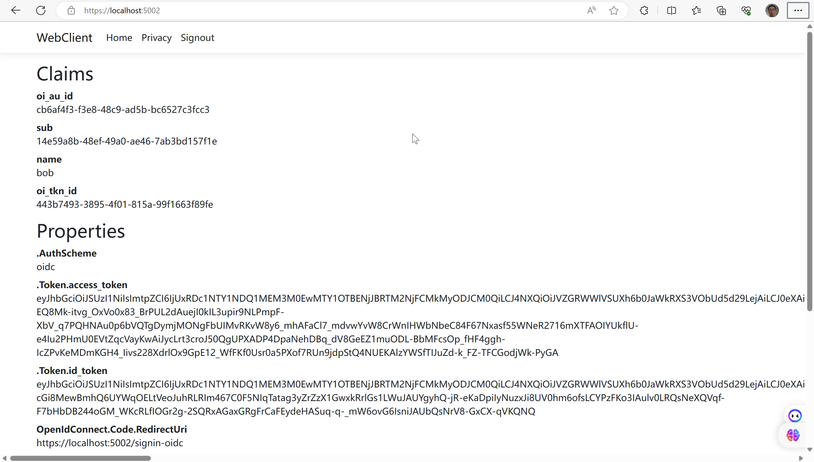
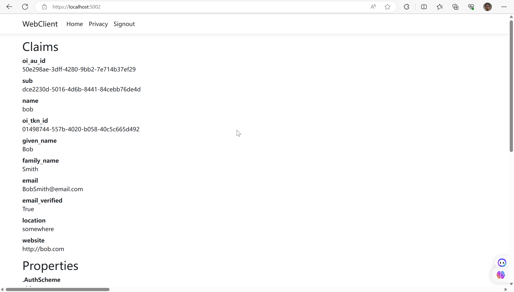

# openiddict实现Authorization Code 流程

在这个快速起步教程中，您将为您在上一节中构建的openiddictServer添加对OpenID Connect协议的交互式用户认证支持。一旦完成，您将创建一个ASP.NET Razor Pages应用程序，该应用程序将使用openiddictServer进行身份验证。

## 配置Openiddict

openiddictServer虽然已经内置了对OpenID Connect协议的支持，但是需要进行一些配置，还需要您需要为登录、注销、同意和错误提供用户界面。

### 协议配置

需要新增一些endpoint用于指定授权、注销、令牌和用户信息的终结点的URI。

接下来，RegisterScopes方法被用来注册支持的范围，即授权请求中可以包括的权限。在示例中，"email"、"profile"和"api1"是支持的范围。

然后，AllowClientCredentialsFlow和AllowAuthorizationCodeFlow方法被用来启用客户端凭据和授权码流程。

最后，UseAspNetCore方法用于注册ASP.NET Core主机，并配置特定于ASP.NET Core的选项。Passthrough方法被用来启用授权、注销、令牌和用户信息的终结点中间件的路由功能，以便将请求直接转发到授权服务器中。

```csharp
// Enable the authorization, logout, token and userinfo endpoints.  
options  
	.SetAuthorizationEndpointUris("connect/authorize")  
	.SetLogoutEndpointUris("connect/logout")  
	.SetTokenEndpointUris("connect/token")  
	.SetUserinfoEndpointUris("connect/userinfo");
	
// Mark the "email", "profile" and "roles" scopes as supported scopes.  
options.RegisterScopes(Scopes.Email, Scopes.Profile, "api1" );

// Enable the client credentials and authorization code flow.  
options.AllowClientCredentialsFlow()  
	.AllowAuthorizationCodeFlow();

// Register the ASP.NET Core host and configure the ASP.NET Core-specific options.  
options.UseAspNetCore()  
	.EnableAuthorizationEndpointPassthrough()  
	.EnableLogoutEndpointPassthrough()  
	.EnableTokenEndpointPassthrough()  
	.EnableUserinfoEndpointPassthrough();
```

### 注册客户端

在代码块内部，首先创建了一个 OpenIddictApplicationDescriptor 对象，它描述了要创建的客户端的属性。接着，代码为该客户端设置了以下属性：

- RedirectUris：重定向 URI 的列表，使用一个包含 "[https://localhost:5002/signin-oidc](https://localhost:5002/signin-oidc)" 的 Uri 对象。
- PostLogoutRedirectUris：注销后重定向 URI 的列表，使用一个包含 "[https://localhost:5002/signout-callback-oidc](https://localhost:5002/signout-callback-oidc)" 的 Uri 对象。
- Permissions：客户端的权限列表，包括访问 token、访问注销点和授权点的权限，以及授权类型和响应类型的权限，还包括 "Profile" 和 "Email" 这两个作用域。
- 使用 ConsentTypes.Implicit，表示隐式同意。

```csharp
// interactive ASP.NET Core Web App
if (await manager.FindByClientIdAsync("web") == null)
{
	await manager.CreateAsync(new OpenIddictApplicationDescriptor
	{
		ClientId = "web",
		ClientSecret = "secret",
		DisplayName = "My web application",
		
		ConsentType = ConsentTypes.Implicit,
		
		RedirectUris =
		{
			new Uri("https://localhost:5002/signin-oidc")
		},
		
		PostLogoutRedirectUris =
		{
			new Uri("https://localhost:5002/signout-callback-oidc")
		},
		
		Permissions =
		{
			Permissions.Endpoints.Token,
			Permissions.Endpoints.Logout,
			Permissions.Endpoints.Authorization,
			
			Permissions.GrantTypes.AuthorizationCode,
			Permissions.ResponseTypes.Code,
			
			Permissions.Scopes.Profile,
			Permissions.Scopes.Email,
		}
	});
}
```

### 新增授权端点


```csharp
var result = await HttpContext.AuthenticateAsync(IdentityConstants.ApplicationScheme);

var user = await _userManager.GetUserAsync(result.Principal);

var application = await _applicationManager.FindByClientIdAsync(request.ClientId);

switch (await _applicationManager.GetConsentTypeAsync(application)){
	case ConsentTypes.Implicit:
		var identity = new ClaimsIdentity(  
authenticationType: TokenValidationParameters.DefaultAuthenticationType,  
nameType: Claims.Name,  
roleType: Claims.Role);  
  
// Add the claims that will be persisted in the tokens.  
identity.SetClaim(Claims.Subject, await _userManager.GetUserIdAsync(user))  
.SetClaim(Claims.Email, await _userManager.GetEmailAsync(user))  
.SetClaim(Claims.Name, await _userManager.GetUserNameAsync(user))  
.SetClaims(Claims.Role, (await _userManager.GetRolesAsync(user)).ToImmutableArray());  
  
// Note: in this sample, the granted scopes match the requested scope  
// but you may want to allow the user to uncheck specific scopes.  
// For that, simply restrict the list of scopes before calling SetScopes.  
identity.SetScopes(request.GetScopes());  
identity.SetResources(await _scopeManager.ListResourcesAsync(identity.GetScopes()).ToListAsync());  
  
identity.SetDestinations(GetDestinations);  
  
return SignIn(new ClaimsPrincipal(identity), OpenIddictServerAspNetCoreDefaults.AuthenticationScheme);
}
```

与客户端凭据流不同，授权码流需要用户的批准。请记住，在我们的项目中已经实现了身份验证。因此，在授权方法中，我们只是确定用户是否已经登录，如果没有，则将用户重定向到登录页面。

当用户通过身份验证时，将创建一个新的声明主体，用于使用OpenIddict身份验证机制进行登录。

如果目标设定为AccessToken，您可以将声明添加到主体中，这些声明将添加到访问令牌中。`Subject`声明是必需的，并且始终会添加到访问令牌中，您无需为此声明指定目标。

客户端请求的作用域都在调用claimsPrincipal.SetScopes(request.GetScopes())时给出，因为在这个示例中我们没有实现同意屏幕，以保持简单。当您实现同意屏幕时，这将是筛选请求的作用域的地方。

"SignIn"调用会触发OpenIddict中间件发送一个授权码，客户端可以通过调用令牌端点来交换该授权码以获取访问令牌。


### 修改令牌端点

由于我们现在支持授权码流程，我们还需要更改令牌终端点：

```csharp
if (request.IsAuthorizationCodeGrantType() || request.IsRefreshTokenGrantType())
{
	// Retrieve the claims principal stored in the authorization code/refresh token.
	var result = await HttpContext.AuthenticateAsync(OpenIddictServerAspNetCoreDefaults.AuthenticationScheme);

	// Retrieve the user profile corresponding to the authorization code/refresh token.
	var user = await _userManager.FindByIdAsync(result.Principal.GetClaim(Claims.Subject));

	// Ensure the user is still allowed to sign in.
	await _signInManager.CanSignInAsync(user)

	var identity = new ClaimsIdentity(result.Principal.Claims,
	authenticationType: TokenValidationParameters.DefaultAuthenticationType,
	nameType: Claims.Name,
	roleType: Claims.Role);

	// Override the user claims present in the principal in case they
	// changed since the authorization code/refresh token was issued.
	identity.SetClaim(Claims.Subject, await _userManager.GetUserIdAsync(user))
		.SetClaim(Claims.Email, await _userManager.GetEmailAsync(user))
		.SetClaim(Claims.Name, await _userManager.GetUserNameAsync(user))
		.SetClaims(Claims.Role, (await _userManager.GetRolesAsync(user)).ToImmutableArray());

	identity.SetDestinations(GetDestinations);

	// Returning a SignInResult will ask OpenIddict to issue the appropriate access/identity tokens.
	return SignIn(new ClaimsPrincipal(identity), OpenIddictServerAspNetCoreDefaults.AuthenticationScheme);
}
```

首先，使用 OpenIddictServerAspNetCoreDefaults.AuthenticationScheme 来异步验证授权码/刷新令牌中的声明主体（claims principal）。

然后，使用 result.Principal.GetClaim(Claims.Subject) 获取声明主体中的主题（subject）声明，并使用该主题来异步查找对应的用户。

接下来，使用 _signInManager.CanSignInAsync(user) 来确保用户仍然允许登录。

创建一个新的 ClaimsIdentity 对象，使用 result.Principal.Claims 中的声明来初始化它。authenticationType 参数指定了 TokenValidationParameters.DefaultAuthenticationType，默认为验证类型。nameType 和 roleType 参数分别指定了声明中的名称（name）和角色（role）声明的类型。

使用 identity.SetClaim 方法追加或修改声明。根据用户的属性，更新了声明中的主题、电子邮件和名称声明，还更新了角色声明。

最后调用SignIn方法。OpenIddict将会响应一个访问令牌。


## 创建OIDC客户端

该客户端与[[2-authorization-code]]相同。


## 测试客户端

现在一切都应该准备就绪，可以使用OIDC登录WebClient。运行IdentityServer和WebClient，然后通过访问受保护的主页触发认证握手。您应该会看到重定向到IdentityServer的登录页面。

在的登录界面输入配置好的用户bob，登录成功跳转回主页显示cookie信息。参数中`Properties.Token`有保存的`access_token`，`id_token`。




## 添加登出

当您从身份验证方案中注销时，cookie auth处理程序会清除本地cookie。当您从其方案中注销时，OpenId Connect处理程序将执行与openiddictServer的往返协议步骤。

```csharp
[ActionName(nameof(Logout)), HttpPost("~/connect/logout"), ValidateAntiForgeryToken]
public async Task<IActionResult> LogoutPost()
{
	// Ask ASP.NET Core Identity to delete the local and external cookies created
	// when the user agent is redirected from the external identity provider
	// after a successful authentication flow (e.g Google or Facebook).
	await _signInManager.SignOutAsync();

	// Returning a SignOutResult will ask OpenIddict to redirect the user agent
	// to the post_logout_redirect_uri specified by the client application or to
	// the RedirectUri specified in the authentication properties if none was set.
	return SignOut(
		authenticationSchemes: OpenIddictServerAspNetCoreDefaults.AuthenticationScheme,
		properties: new AuthenticationProperties
		{
			RedirectUri = "/"
		});
}
```

## 通过UserInfo endpoint获取用户Claims

你可能注意到，即使你已经配置了客户端允许检索个人配置范围（profile identity scope），与该范围相关的声明（如姓名、姓氏、网站等）也不会出现在返回的令牌中。你需要告诉客户端从用户信息端点检索这些声明，方法是指定客户端应用程序需要访问的范围并设置GetClaimsFromUserInfoEndpoint选项。

```csharp
options.Scope.Add("openid");  
options.Scope.Add("profile");  
options.ClaimActions.MapJsonKey("email_verified", "email_verified");  
options.ClaimActions.MapJsonKey("location","location");  
options.ClaimActions.MapJsonKey("website","website");  
options.GetClaimsFromUserInfoEndpoint = true;
```

### 添加UserInfo endpoint

```csharp
//
// GET: /api/userinfo
[Authorize(AuthenticationSchemes = OpenIddictServerAspNetCoreDefaults.AuthenticationScheme)]
[HttpGet("~/connect/userinfo"), HttpPost("~/connect/userinfo"), Produces("application/json")]
public async Task<IActionResult> Userinfo()
{
	var user = await _userManager.FindByIdAsync(User.GetClaim(Claims.Subject));

	var claims = new Dictionary<string, object>(StringComparer.Ordinal)
	{
		// Note: the "sub" claim is a mandatory claim and must be included in the JSON response.
		[Claims.Subject] = await _userManager.GetUserIdAsync(user)
	};

	if (User.HasScope(Scopes.Profile))
	{
		var userClaims =await _userManager.GetClaimsAsync(user);
		claims[Claims.Name] = await _userManager.GetUserNameAsync(user);
		claims[Claims.GivenName] = userClaims.FirstOrDefault(c => c.Type == Claims.GivenName)?.Value;
		claims[Claims.FamilyName] = userClaims.FirstOrDefault(c => c.Type == Claims.FamilyName)?.Value;
		claims[Claims.Website] = userClaims.FirstOrDefault(c => c.Type == Claims.Website)?.Value;
		claims["location"] = userClaims.FirstOrDefault(c => c.Type == "location")?.Value;
	}

	if (User.HasScope(Scopes.Email))
	{
		claims[Claims.Email] = await _userManager.GetEmailAsync(user);
		claims[Claims.EmailVerified] = await _userManager.IsEmailConfirmedAsync(user);
	}

	if (User.HasScope(Scopes.Phone))
	{
		claims[Claims.PhoneNumber] = await _userManager.GetPhoneNumberAsync(user);
		claims[Claims.PhoneNumberVerified] = await _userManager.IsPhoneNumberConfirmedAsync(user);
	}

	if (User.HasScope(Scopes.Roles))
	{
		claims[Claims.Role] = await _userManager.GetRolesAsync(user);
	}

	// Note: the complete list of standard claims supported by the OpenID Connect specification
	// can be found here: http://openid.net/specs/openid-connect-core-1_0.html#StandardClaims

	return Ok(claims);
}
```


在该方法中，首先使用输入参数`User.GetClaim(Claims.Subject)`获取用户的主题（subject）信息，然后通过`_userManager.FindByIdAsync`方法查找对应的用户对象。

接下来，根据请求的范围（scope），通过`User.HasScope`方法判断用户是否有相应的权限，并根据权限获取相应的用户信息。    

将获取到的用户信息按照键值对的形式添加到`claims`字典中。

### 添加自定义的Claims

客户端提添加Scope方式与IdentityServer方式一样[[2-authorization-code]]

openiddictServer 添加服务时，需要指定新添加的scope。

```csharp
// Register the OpenIddict server components.
.AddServer(options =>
{
	...
	// Mark the "email", "profile" and "roles" scopes as supported scopes.
	options.RegisterScopes(Scopes.Email, Scopes.Profile, "api1","verification" );
	...
}
```

UserInfo endpoint 端添加该Scope对应的Claims。

```csharp
if(User.HasScope("verification"))  
{  
	claims[Claims.Email] = await _userManager.GetEmailAsync(user);  
	claims[Claims.EmailVerified] = await _userManager.IsEmailConfirmedAsync(user);  
}
```

测试


