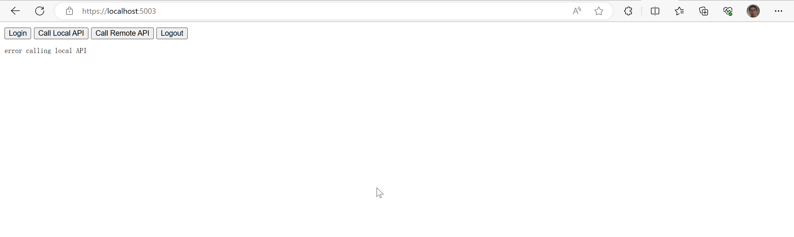

# 具有后端服务的javascript应用

构建JavaScript（或SPA）应用程序时，有两种主要的风格：具有后端和没有后端的风格。

具有后端的JavaScript应用程序更安全，这是首选风格。这种风格使用“Backend For Frontend”（简称BFF）模式，依赖于后端主机来实现与令牌服务器的所有安全协议交互。

## JavaScriptClient创建

首先，创建一个新项目来托管JavaScript应用程序和其BFF（Backend for Frontend）。将前端和其BFF放在同一个主机上的单个项目可以方便地进行cookie身份验证-前端和BFF需要在同一主机上，这样才能将cookie从前端发送到BFF。

添加依赖包

```
dotnet add package Microsoft.AspNetCore.Authentication.OpenIdConnect
dotnet add package Yarp.ReverseProxy
```

因为用到了反向代理所以添加Yarp.ReverseProxy包。

### 添加服务

在BFF模式中，服务器端的代码触发并接收OpenID Connect的请求和响应。为了做到这一点，它需要与WebClient在之前的Web应用快速入门中进行相同的服务配置。

```csharp
builder.Services.AddControllers();
builder.Services
    .AddAuthentication(options =>
    {
        options.DefaultScheme = "Cookies";
        options.DefaultChallengeScheme = "oidc";
        options.DefaultSignOutScheme = "oidc";
    })
    .AddCookie("Cookies")
    .AddOpenIdConnect("oidc", options =>
    {
        options.Authority = "https://localhost:5001";
        options.ClientId = "bff";
        options.ClientSecret = "secret";
        options.ResponseType = "code";
        options.Scope.Add("api1");
        options.SaveTokens = true;
        options.GetClaimsFromUserInfoEndpoint = true;
    });

// Create an authorization policy used by YARP when forwarding requests
// from the WASM application to the Dantooine.Api resource server.
builder.Services.AddAuthorization(options => options.AddPolicy("CookieAuthenticationPolicy", builder =>
{
    builder.AddAuthenticationSchemes(CookieAuthenticationDefaults.AuthenticationScheme);
    builder.RequireAuthenticatedUser();
}));

builder.Services.AddReverseProxy()
    .LoadFromConfig(builder.Configuration.GetSection("ReverseProxy"))
    .AddTransforms(builder => builder.AddRequestTransform(async context =>
    {
        // Attach the access token retrieved from the authentication cookie.
        //
        // Note: in a real world application, the expiration date of the access token
        // should be checked before sending a request to avoid getting a 401 response.
        // Once expired, a new access token could be retrieved using the OAuth 2.0
        // refresh token grant (which could be done transparently).
        var token = await context.HttpContext.GetTokenAsync(
            scheme: CookieAuthenticationDefaults.AuthenticationScheme,
            tokenName: "access_token");

        context.ProxyRequest.Headers.Authorization = new AuthenticationHeaderValue(OpenIddictConstants.Schemes.Bearer, token);
    }));
```

AddReverseProxyx这段代码配置了一个反向代理服务，该服务在收到请求时会使用OpenIddict的身份验证中间件来获取访问令牌，然后将该令牌添加到代理请求的Authorization头中，并将请求转发给目标服务器。

反向代理的配置项如下：

```json
"ReverseProxy": {
"Routes": {
  "route1": {
	"ClusterId": "cluster1",
	"AuthorizationPolicy": "CookieAuthenticationPolicy",
	"Match": {
	  "Path": "remote/{**catch-all}"
	},
	"Transforms": [
		{
			"PathRemovePrefix": "/remote"
		}
	]
  }
},

"Clusters": {
  "cluster1": {
	"Destinations": {
	  "cluster1/destination1": {
		"Address": "https://localhost:6001/"
	  }
	}
  }
}
}
```


### 添加登入登出

该案例的登入登出没有像Duende.BFF库支持，需要我们手动添加登入登出的逻辑

```csharp
[HttpGet("~/bff/login")]
public ActionResult LogIn(string returnUrl)
{
	var properties = new AuthenticationProperties
	{
		// Only allow local return URLs to prevent open redirect attacks.
		RedirectUri = Url.IsLocalUrl(returnUrl) ? returnUrl : "/"
	};

	// Ask the OpenIddict client middleware to redirect the user agent to the identity provider.
	return Challenge(properties);
}
```

代码使用Challenge()方法将用户重定向到身份提供者。Challenge()方法将传递AuthenticationProperties对象作为参数，以指定重定向URL。由于该方法是在HTTP GET请求中调用的，它会触发OpenIddict客户端中间件将用户代理重定向到身份提供者，以进行身份验证。

```csharp
[HttpGet("~/bff/logout"), /*ValidateAntiForgeryToken */]
public async Task<ActionResult> LogOut(string returnUrl)
{
	// Retrieve the identity stored in the local authentication cookie. If it's not available,
	// this indicate that the user is already logged out locally (or has not logged in yet).
	var result = await HttpContext.AuthenticateAsync(CookieAuthenticationDefaults.AuthenticationScheme);
	if (result is not { Succeeded: true })
	{
		// Only allow local return URLs to prevent open redirect attacks.
		return Redirect(Url.IsLocalUrl(returnUrl) ? returnUrl : "/");
	}

	// Remove the local authentication cookie before triggering a redirection to the remote server.
	await HttpContext.SignOutAsync(CookieAuthenticationDefaults.AuthenticationScheme);

	var properties = new AuthenticationProperties{
		// Only allow local return URLs to prevent open redirect attacks.
		RedirectUri = Url.IsLocalUrl(returnUrl) ? returnUrl : "/"
	};

	// Ask the OpenIddict client middleware to redirect the user agent to the identity provider.
	return SignOut(properties);
}
```

通过`HttpContext.SignOutAsync`异步方法来移除本地身份验证Cookie，即注销用户。

接着，创建一个新的`AuthenticationProperties`对象，并设置其`RedirectUri`属性为`returnUrl`。同样地，只允许本地URL，以防止开放式重定向攻击。

最后，使用`SignOut(properties)`方法来请求OpenIddict客户端中间件将用户重定向到身份提供者，进行身份认证的注销操作。

最终，该方法将返回这个重定向请求。

### 添加 JavaScript 客户端代码

使用JavaScript客户端和[[6-javascript-with-backend]]相同。


## openiddict服务注册bff客户端

现在客户端应用程序已经准备就绪，你需要在openiddcit中为新的JavaScript客户端定义一个配置项。

```csharp
// BFF client
if (await manager.FindByClientIdAsync("bff") == null)
{
	await manager.CreateAsync(new OpenIddictApplicationDescriptor
	{
		ClientId = "bff",
		ClientSecret = "secret",
		DisplayName = "My bff application",

		RedirectUris =
		{
			new Uri("https://localhost:5003/signin-oidc")
		},
		
		PostLogoutRedirectUris =
		{
			new Uri("https://localhost:5003/signout-callback-oidc")
		},
		
		Permissions =
		{
			Permissions.Endpoints.Token,
			Permissions.Endpoints.Logout,
			Permissions.Endpoints.Authorization,
			
			Permissions.GrantTypes.AuthorizationCode,
			Permissions.ResponseTypes.Code,
			
			Permissions.Scopes.Profile,
			Permissions.Prefixes.Scope + "api1",
		}

	});
}
```

## 测试登入和登出

在这个阶段，你应该可以运行JavaScriptClient应用程序。你应该能看到用户最初没有登录。




当您点击登录按钮时，您将被重定向到IdentityServer进行登录。登录成功后，您将被重定向回JavaScriptClient应用程序，您将被以Cookies身份验证方案登录，并将您的令牌保存在会话中。

## 调用本地API 和 远端API

调用和测试和[[6-javascript-with-backend]]相同。