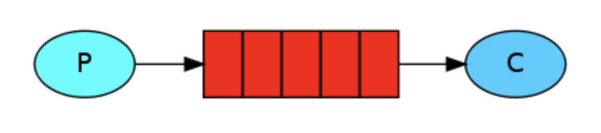
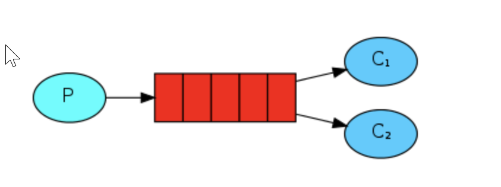
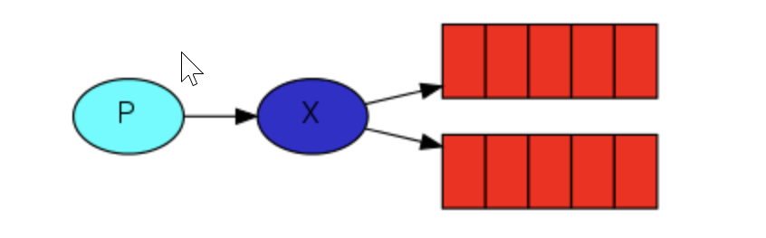
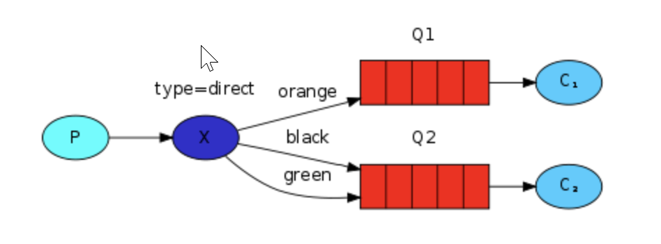
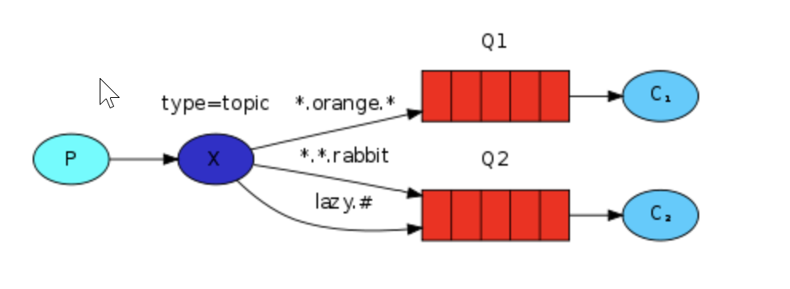
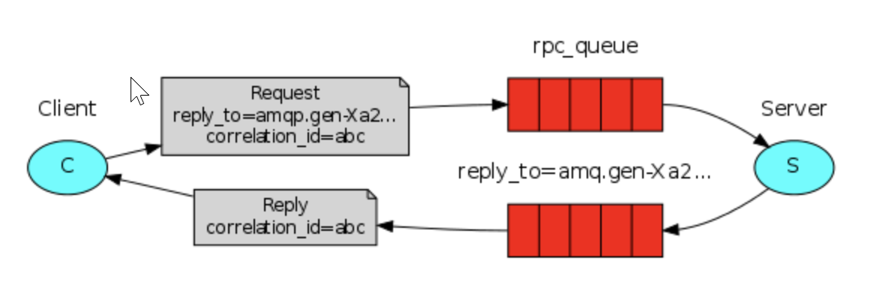

# Rabbitmq 使用模式

### 简单模式（Hello World）

做最简单的事情，一个生产者对应一个消费者，RabbitMQ相当于一个消息代理，负责将A的消息转发给B

**应用场景：** 将发送的电子邮件放到消息队列，然后邮件服务在队列中获取邮件并发送给收件人

### 工作队列模式（Work queues）

在多个消费者之间分配任务（竞争的消费者模式），一个生产者对应多个消费者，一般适用于执行资源密集型任务，单个消费者处理不过来，需要多个消费者进行处理

**应用场景：** 一个订单的处理需要10s，有多个订单可以同时放到消息队列，然后让多个消费者同时处理，这样就是并行了，而不是单个消费者的串行情况

### 订阅模式（Publish/Subscribe）

一次向许多消费者发送消息，一个生产者发送的消息会被多个消费者获取，也就是将消息将广播到所有的消费者中。

**应用场景：** 更新商品库存后需要通知多个缓存和多个数据库，这里的结构应该是：

- 一个fanout类型交换机扇出两个个消息队列，分别为缓存消息队列、数据库消息队列
- 一个缓存消息队列对应着多个缓存消费者
- 一个数据库消息队列对应着多个数据库消费者

### 路由模式（Routing）

有选择地（Routing key）接收消息，发送消息到交换机并且要指定路由key ，消费者将队列绑定到交换机时需要指定路由key，仅消费指定路由key的消息

**应用场景：** 如在商品库存中增加了1台iphone12，iphone12促销活动消费者指定routing key为iphone12，只有此促销活动会接收到消息，其它促销活动不关心也不会消费此routing key的消息

### 主题模式（Topics）

根据主题（Topics）来接收消息，将路由key和某模式进行匹配，此时队列需要绑定在一个模式上，`#`匹配一个词或多个词，`*`只匹配一个词。

**应用场景：** 同上，iphone促销活动可以接收主题为iphone的消息，如iphone12、iphone13等

### 远程过程调用（RPC）

如果我们需要在远程计算机上运行功能并等待结果就可以使用RPC，具体流程可以看图。应用场景：需要等待接口返回数据，如订单支付

### 发布者确认（Publisher Confirms）

与发布者进行可靠的发布确认，发布者确认是RabbitMQ扩展，可以实现可靠的发布。在通道上启用发布者确认后，RabbitMQ将异步确认发送者发布的消息，这意味着它们已在服务器端处理。

**应用场景：** 对于消息可靠性要求较高，比如钱包扣款

### 四种交换机

直连交换机（Direct exchange）： 具有路由功能的交换机，绑定到此交换机的时候需要指定一个routing_key，交换机发送消息的时候需要routing_key，会将消息发送道对应的队列

扇形交换机（Fanout exchange）： 广播消息到所有队列，没有任何处理，速度最快

主题交换机（Topic exchange）： 在直连交换机基础上增加模式匹配，也就是对routing_key进行模式匹配，\*代表一个单词，#代表多个单词

Header交换机（Headers exchange）： 忽略routing_key，使用Headers信息（一个Hash的数据结构）进行匹配，优势在于可以有更多更灵活的匹配规则