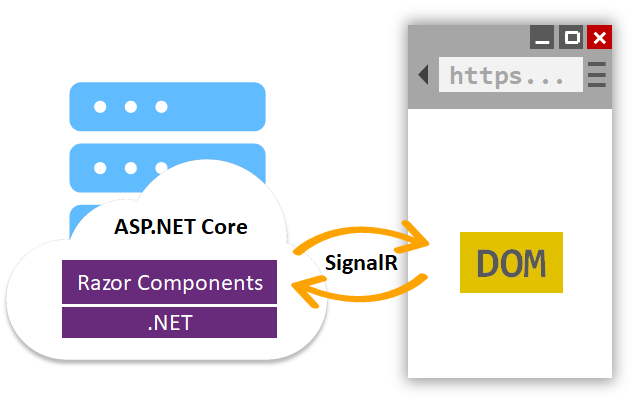
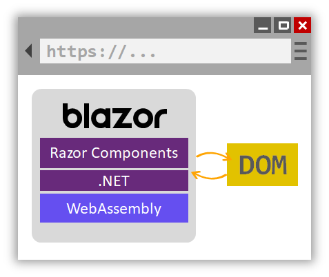

# blazor开始

文档地址：[ASP.NET Core Blazor | Microsoft Learn](https://learn.microsoft.com/en-us/aspnet/core/blazor/?view=aspnetcore-7.0)

Blazor是一个使用.NET构建交互式客户端Web UI的框架。

* 使用C#创建丰富的交互式用户界面。
* 共享在.NET中编写的服务器端和客户端应用程序逻辑。
* 将UI渲染为HTML和CSS，以支持广泛的浏览器，包括移动浏览器。
* 使用.NET和Blazor构建混合桌面和移动应用程序。

### 组件

Blazor应用程序基于组件。在Blazor中，组件是UI的元素，例如页面、对话框或数据输入表单。

组件有以下特点：

* 定义灵活的用户界面渲染逻辑。
* 处理用户事件。
* 可以嵌套和重复使用。
* 可以作为Razor类库或NuGet包进行共享和分发。

组件类通常以 `.razor` 文件扩展名的Razor标记页形式编写。在Blazor中，组件正式称为Razor组件，非正式称为Blazor组件。Razor是一种将HTML标记与C#代码结合的语法，旨在提高开发人员的生产力。Razor允许您在同一文件中在HTML标记和C#之间切换。

Blazor使用自然的HTML标签进行UI组合。以下的Razor标记演示了一个组件，当用户选择一个按钮时，它会增加一个计数器。

```html
<PageTitle>Counter</PageTitle>

<h1>Counter</h1>

<p role="status">Current count: @currentCount</p>

<button class="btn btn-primary" @onclick="IncrementCount">Click me</button>

@code {
    private int currentCount = 0;

    private void IncrementCount()
    {
        currentCount++;
    }
}
```

### Blazor Server

Blazor Server 在 ASP.NET Core 应用程序中提供了对 Razor 组件在服务器上进行托管的支持。UI 更新通过 SignalR 连接处理。

页面的渲染工作将在服务器中进行，将浏览器中的用户界面事件发送到服务器，由服务器发送回来的UI更新应用到渲染组件中。


不同于传统的UI的选渲染方式（Razor Pages），虽然两者都是使用Razor语言来描述Html页面，但是Blazor在客户端上进行交互后，用户交互和应用程序事件会触发UI更新。当更新发生时，组件图会重新渲染，并计算出UI差异（difference）。这个差异是在客户端上更新UI所需的最小一组DOM编辑。差异以二进制格式发送到客户端，并由浏览器应用。

Blazor Server 生成一个类似于 HTML 或 XML DOM 的components graph来显示。components graph包括在属性和字段的状态。Blazor 评估components graph 以生成二进制表示的标记（Razor），然后将其发送到客户端进行渲染。在客户端和服务器之间建立连接后，组件的静态预渲染元素将被交互元素替换。在服务器上预渲染内容使应用程序在客户端上感觉更加响应。

### Blazor WebAssembly

Blazor WebAssembly 是一个用于使用 .NET 构建交互式客户端 Web 应用程序的单页应用 (SPA) 框架。

在Web浏览器中运行.NET代码是通过WebAssembly（简称为 `wasm` ）实现的。WebAssembly是一种紧凑的字节码格式，经过优化以实现快速下载和最大执行速度。WebAssembly是一个开放的Web标准，在Web浏览器中无需插件即可支持。WebAssembly适用于所有现代Web浏览器，包括移动浏览器。

WebAssembly代码可以通过JavaScript访问浏览器的全部功能，称为JavaScript互操作性，通常简称为JavaScript互操作或JS互操作。在浏览器中通过WebAssembly执行的.NET代码将在浏览器的JavaScript沙盒中运行，并受到沙盒提供的保护，以防止对客户端机器进行恶意操作。


当构建和运行Blazor WebAssembly应用程序时：

* C#代码文件和Razor文件被编译成.NET程序集。
* 组件和.NET运行时被下载到浏览器中。
* Blazor WebAssembly引导.NET运行时并配置运行时以加载应用程序的程序集。Blazor WebAssembly运行时使用JavaScript互操作处理DOM操作和浏览器API调用。

### Blazor Hybrid

混合应用程序使用本地和Web技术的组合。Blazor混合应用程序在本地客户端应用程序中使用Blazor。Razor组件在.NET进程中本地运行，并使用本地互操作通道将Web UI渲染到嵌入式Web视图控件中。混合应用程序不使用WebAssembly。混合应用程序涵盖以下技术：

* *.NET多平台应用程序UI（.NET MAUI）：一个使用C#和XAML创建本机移动和桌面应用程序的跨平台框架。
* Windows Presentation Foundation (WPF)：一个UI框架，它是分辨率无关的，并使用矢量渲染引擎，旨在充分利用现代图形硬件。
* Windows Forms：一个为Windows创建丰富桌面客户端应用程序的UI框架。Windows Forms开发平台支持广泛的应用程序开发功能，包括控件、图形、数据绑定和用户输入。

