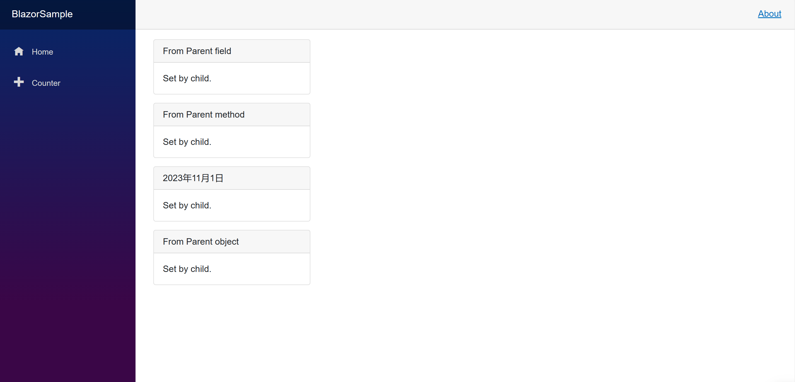
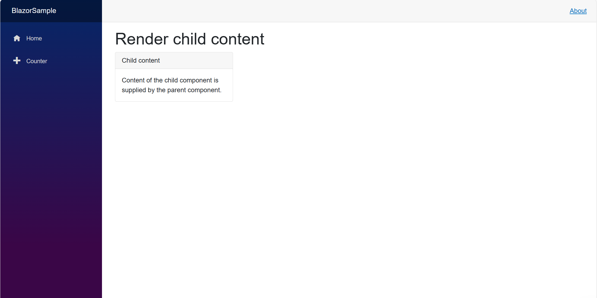
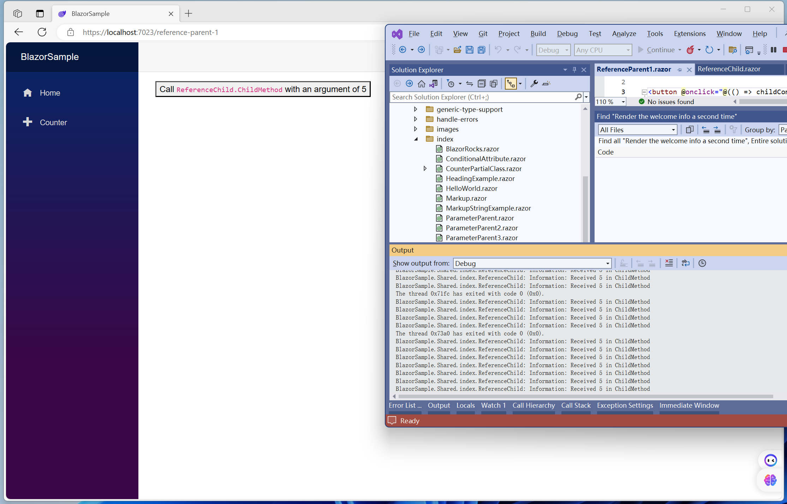
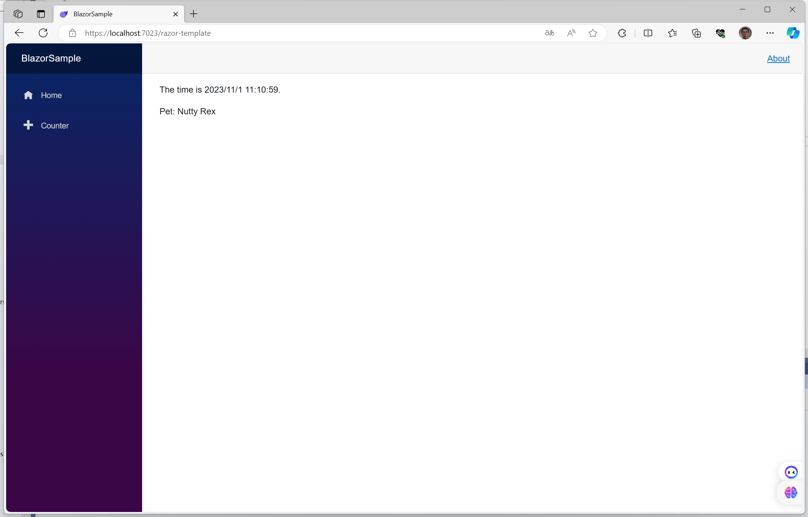

# blazor组件

文档地址：[ASP.NET Core Razor components | Microsoft Learn](https://learn.microsoft.com/en-us/aspnet/core/blazor/components/?view=aspnetcore-7.0)

Blazor应用程序使用Razor组件构建，非正式地称为Blazor组件或仅组件。组件是用户界面（UI）的自包含部分，具有处理逻辑以实现动态行为。组件可以嵌套、重用、在项目之间共享，并且可以在MVC和Razor Pages应用程序中使用。

组件渲染成浏览器的文档对象模型（DOM）的内存表示，称为渲染树，用于以灵活高效的方式更新用户界面。

### Component 类

ComponentBase是由Razor组件文件描述的组件的基类。ComponentBase实现了组件的最低抽象，即IComponent接口。ComponentBase定义了组件的属性和方法，用于基本功能，例如处理一组内置组件生命周期事件。


### Razor syntax

组件使用Razor语法。组件广泛使用两个Razor特性，即指令和指令属性。这些是出现在Razor标记中以 `@` 为前缀的保留关键字。

* 指令：更改组件标记的解析方式或功能。例如， `@page` 指令指定了一个可路由的组件，具有路由模板，并且可以通过用户在浏览器中的特定 URL 直接访问。

* 指令属性：改变组件元素的解析方式或功能。例如，对于 `<input>` 元素， `@bind` 指令属性将数据绑定到元素的值。


### 部分类支持

组件以C#部分类的形式生成，并使用以下任一方法进行编写：

* 一个单一的文件包含了一个或多个 `@code` 块中定义的C#代码、HTML标记和Razor标记。Blazor项目模板使用这种单一文件的方法来定义它们的组件。
* HTML和Razor标记放置在Razor文件中（ `.razor` ）。C#代码放置在一个被定义为部分类的代码后台文件中（ `.cs` ）。（建议）


### 嵌套组件

组件可以通过使用HTML语法来声明其他组件。使用组件的标记看起来像一个HTML标签，其中标签的名称是组件类型。

[blazor-samples/7.0/BlazorSample_Server/Pages/index/HeadingExample.razor at main · dotnet/blazor-samples (github.com)](https://github.com/dotnet/blazor-samples/blob/main/7.0/BlazorSample_Server/Pages/index/HeadingExample.razor)


## 组件参数

组件参数将数据传递给组件，并使用组件类上的公共 C# 属性进行定义，属性上带有 `[Parameter]` 属性。

[blazor-samples/7.0/BlazorSample_Server/Pages/index/ParameterParent.razor at main · dotnet/blazor-samples (github.com)](https://github.com/dotnet/blazor-samples/blob/main/7.0/BlazorSample_Server/Pages/index/ParameterParent.razor)


```cshtml
<div class="card w-25" style="margin-bottom:15px">
    <div class="card-header font-weight-bold">@Title</div>
    <div class="card-body" style="font-style:@Body.Style">
        @Body.Text
    </div>
</div>

@code {
    [Parameter]
    public string Title { get; set; } = "Set By Child";

    [Parameter]
    public PanelBody Body { get; set; } =
        new()
        {
            Text = "Set by child.",
            Style = "normal"
        };
}

```

`Title` 和 `Body` 组件参数是通过HTML标签中的参数来设置的，该标签用于渲染组件的实例。下面的 `ParameterParent` 组件渲染了两个 `ParameterChild` 组件：

```cshtml
@page "/parameter-parent"

<h1>Child component (without attribute values)</h1>

<ParameterChild />

<h1>Child component (with attribute values)</h1>

<ParameterChild Title="Set by Parent"
                Body="@(new PanelBody() { Text = "Set by parent.", Style = "italic" })" />

```

第二个 `ParameterChild` 组件从 `ParameterParent` 组件接收 `Title` 和 `Body` 的值，后者使用明确的C#表达式来设置 `PanelBody` 属性的值。


将C#字段、属性或方法的结果分配给组件参数，作为HTML属性值。属性的值通常可以是与参数类型匹配的任何C#表达式。

```cshtml
@page "/parameter-parent-2"

<ParameterChild Title="@title" />

<ParameterChild Title="@GetTitle()" />

<ParameterChild Title="@DateTime.Now.ToLongDateString()" />

<ParameterChild Title="@panelData.Title" />

@code {
    private string title = "From Parent field";
    private PanelData panelData = new();

    private string GetTitle()
    {
        return "From Parent method";
    }

    private class PanelData
    {
        public string Title { get; set; } = "From Parent object";
    }
}

```

效果如下：



## 子内容渲染片段（Child content render fragments）

组件可以设置另一个组件的内容。赋值组件在子组件的起始标签和结束标签之间提供内容。

在下面的示例中， `RenderFragmentChild` 组件具有一个 `ChildContent` 组件参数，该参数表示要作为RenderFragment呈现的UI段。在组件的Razor标记中， `ChildContent` 的位置是最终HTML输出中呈现内容的位置。

```cshtml
<div class="card w-25" style="margin-bottom:15px">
    <div class="card-header font-weight-bold">Child content</div>
    <div class="card-body">@ChildContent</div>
</div>

@code {
    [Parameter]
    public RenderFragment? ChildContent { get; set; }
}

```

以下的 `RenderFragmentParent` 组件通过将内容放置在子组件的开始和结束标签之间，为渲染 `RenderFragmentChild` 提供内容。

```cshtml
@page "/render-fragment-parent"

<h1>Render child content</h1>

<RenderFragmentChild>
    Content of the child component is supplied
    by the parent component.
</RenderFragmentChild>

```

效果如下：




## 为可重用的渲染逻辑渲染片段

您可以将子组件提取出来，纯粹是为了重用渲染逻辑。在任何组件的 `@code` 块中，定义一个RenderFragment，并从任何位置多次渲染该片段。

```cshtml
@RenderWelcomeInfo

<p>Render the welcome info a second time:</p>

@RenderWelcomeInfo

@code {
    private RenderFragment RenderWelcomeInfo =  @<p>Welcome to your new app!</p>;
}
```


## 获取对组件的引用

组件引用提供了一种引用组件实例以发出命令的方式。要捕获组件引用需要：
* 给子组件添加一个 `@ref` 属性。
* 定义一个与子组件相同类型的字段。

当组件被渲染时，该字段将被组件实例填充。然后，您可以在实例上调用.NET方法。

组件引用只有在组件渲染后，并且其输出包含 `ReferenceChild` 元素后才会被填充。在组件渲染之前，没有任何可以引用的内容。


考虑下面的 `ReferenceChild` 组件，在调用其 `ChildMethod` 时记录一条消息。

```razor
@using Microsoft.Extensions.Logging
@inject ILogger<ReferenceChild> Logger

@code {
    public void ChildMethod(int value)
    {
        Logger.LogInformation("Received {Value} in ChildMethod", value);
    }
}
```

以下的lambda方法使用了前面的 `ReferenceChild` 组件。

```razor
@page "/reference-parent-1"

<button @onclick="@(() => childComponent?.ChildMethod(5))">
    Call <code>ReferenceChild.ChildMethod</code> with an argument of 5
</button>

<ReferenceChild @ref="childComponent" />

@code {
    private ReferenceChild? childComponent;
}
```

效果如下：




## 条件HTML元素属性

HTML元素属性的属性是根据.NET值有条件地设置的。如果值是 `false` 或 `null` ，则属性不会被设置。如果值是 `true` ，则属性会被设置。

在下面的示例中， `IsCompleted` 确定 `<input>` 元素的 `checked` 属性是否已设置。

```razor
@page "/conditional-attribute"

<label>
    <input type="checkbox" checked="@IsCompleted" />
    Is Completed?
</label>

<button @onclick="@(() => IsCompleted = !IsCompleted)">
    Change IsCompleted
</button>

@code {
    [Parameter]
    public bool IsCompleted { get; set; }
}
```


## Razor模板

可以使用Razor模板语法来定义渲染片段，以定义UI片段。Razor模板使用以下格式：

```razor
@<{HTML tag}>...</{HTML tag}>
```


以下示例说明了如何指定 RenderFragment 和 RenderFragment 值，并直接在组件中渲染模板。渲染片段也可以作为参数传递给模板化组件。


```razor
@page "/razor-template"

@timeTemplate

@petTemplate(new Pet { Name = "Nutty Rex" })

@code {
    private RenderFragment timeTemplate = @<p>The time is @DateTime.Now.</p>;
    private RenderFragment<Pet> petTemplate = (pet) => @<p>Pet: @pet.Name</p>;

    private class Pet
    {
        public string? Name { get; set; }
    }
}

```

效果如下：




## 渲染静态root Razor组件

root Razor 组件是应用程序创建的任何组件层次结构中加载的第一个组件。

在从Blazor Server项目模板创建的应用程序中， `App` 组件（ `App.razor` ）被指定为 `Pages/_Host.cshtml` 中默认根组件

```cshtml
<component type="typeof(App)" render-mode="ServerPrerendered" />
```

在从Blazor WebAssembly项目模板创建的应用程序中， `App` 组件（ `App.razor` ）被指定为 `Program` 文件中的默认根组件

```csharp
builder.RootComponents.Add<App>("#app");
```